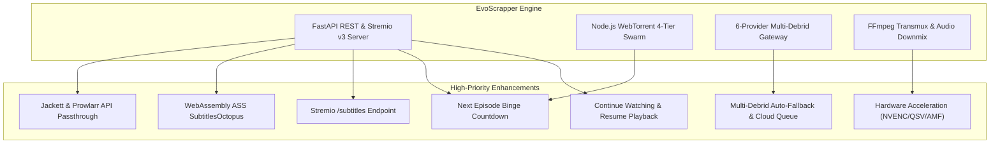

# 🚀 EvoScrapper — Next-Gen Roadmap & Feature Analysis (`NEXT.md`)

> **Comprehensive Architectural Audit, Feature Gap Analysis, and Optimization Blueprint**  
> *Generated: October 2026 | Codebase Version: 2.5.0 | Test Suite: 126/126 Passing (100%)*

---

## 📌 Executive Summary

**EvoScrapper** has matured into an exceptionally capable media engine combining:
- A 12-provider torrent scraping orchestrator with capability routing and circuit breakers.
- A 6-provider Multi-Debrid cloud streaming pipeline with HMAC tokenized stream proxies.
- A 4-tier concurrent P2P WebTorrent streaming engine with custom piece-sliding windows and UPnP/NAT traversal.
- Real-time FFmpeg audio/video transmuxing with dialogue normalization, dual Blu-ray PGS subtitle engines (Server Burn-in & Client-side HTML5 Canvas decoding), and multi-audio track coexistence.
- A custom cinema HUD player with Discover catalog, bookmarks, and Stremio v3 protocol support.

To elevate EvoScrapper from an advanced self-hosted scraper into an **unrivaled, industry-leading media platform**, this document details every missing feature, performance bottleneck, and architectural enhancement categorized by domain, technical complexity, and impact.

---

## 🧭 Priority Matrix & Roadmap Overview

| Priority | Category | Feature / Optimization | Expected Impact |
|:---:|---|---|---|
| **P0** | **Streaming** | Hardware-Accelerated FFmpeg Transcoding (NVENC/QSV/AMF) | 90% CPU reduction during 1080p/4K transcode |
| **P0** | **Player** | Next Episode Auto-Play & Binge Countdown | Seamless series & anime watching experience |
| **P0** | **Player** | Continue Watching & Timestamp Resume Persistence | Essential UX standard across all media platforms |
| **P1** | **Subtitles** | Client-Side ASS/SSA Rendering via `SubtitlesOctopus` (WebAssembly) | Pixel-perfect anime typesetting with 0% server CPU |
| **P1** | **Indexers** | Jackett & Prowlarr Local API Integration | Unlocks 100+ private and specialized trackers |
| **P1** | **Debrid** | Multi-Debrid Automatic Fallback & Cloud Queue Manager | Zero manual switching when streams are uncached |
| **P1** | **Stremio** | Stremio Subtitles Endpoint (`/subtitles`) & `/configure` Portal | Full Stremio v3 ecosystem parity |
| **P2** | **Subtitles** | AI Acoustic Voice Activity Subtitle Auto-Sync | One-click automatic subtitle offset correction |
| **P2** | **Player** | Picture-in-Picture (PiP) & Playback Speed Controls (0.5x–2.0x) | Modern browser video player parity |
| **P2** | **Discover** | Advanced Catalog Filtering (IMDb Range, Release Year, Genres) | High-precision content exploration |
| **P2** | **Catalog** | Trakt.tv / Simkl / MyAnimeList 2-Way Scrobbling | Cross-platform library & watch history synchronization |
| **P3** | **Architecture** | SQLite / DuckDB Database Migration for Library & History | Eliminates file concurrency locks on large datasets |
| **P3** | **DevOps** | Official Multi-Arch Docker Container with GPU Passthrough | 1-command deployment on Unraid, TrueNAS & Linux servers |

---

## 🎬 1. Video Player & Playback Pipeline

### 1.1 Hardware-Accelerated FFmpeg Transcoding (NVENC, QSV, AMF, VideoToolbox)
- **Current State**: [`stream_transmuxed_video`](file:///core/transmuxer.py) encodes video via software `libx264` with `-preset ultrafast -tune zerolatency`. On low-power CPU servers, NAS boxes, or Raspberry Pis, transcoding 1080p 10-bit HEVC or 4K HDR consumes significant CPU resources.
- **Proposed Enhancement**:
  - Implement dynamic encoder detection on application startup (`check_hardware_encoders()`).
  - Auto-select hardware acceleration:
    - **NVIDIA GPU**: `-c:v h264_nvenc -preset p1 -tune ll`
    - **Intel QuickSync (QSV)**: `-c:v h264_qsv -preset veryfast`
    - **AMD (AMF)**: `-c:v h264_amf -quality speed`
    - **Apple Silicon (macOS)**: `-c:v h264_videotoolbox`
    - **Fallback**: CPU `libx264`.
  - Add hardware encoder toggle in Player Settings Studio.
- **Value**: Reduces server CPU usage by over 80–90% during live burn-in and HEVC down-conversions.

### 1.2 "Continue Watching" & Resume Playback Timestamp Persistence
- **Current State**: History is logged on click, but current playback position (`currentTime`) is only partially synced in local component state. If the user refreshes or closes the tab, they have to manually scrub back.
- **Proposed Enhancement**:
  - Throttle-save playback position every 5 seconds to `/api/v1/library/{id}/progress`:
    - `playback_seconds`, `duration_seconds`, `progress_percent`, `season`, `episode`.
  - Add a **"Continue Watching"** carousel at the top of the Discover view featuring progress bars and an instant 1-click **Resume** button.
  - Automatically prompt on player open: *"Resume from 18:42?"* with a 5-second auto-start or *"Play from Beginning"*.

### 1.3 Next Episode Auto-Play & Binge Watch Mode
- **Current State**: When an episode finishes, the video ends and stays at the black credits screen. The user must close the player, find the next episode in the catalog or files modal, and click play.
- **Proposed Enhancement**:
  - Detect when remaining playback time `< 40 seconds` or on video `ended` event.
  - Display a floating non-intrusive **"Next Episode (S01E17)"** countdown pill in the bottom-right corner with a 10-second timer and an instant *"Play Now"* / *"Cancel"* button.
  - Pre-warm the next episode torrent pieces in the background 60 seconds before current episode ends for zero-wait transition.

### 1.4 Native Picture-in-Picture (PiP) Support
- **Current State**: The custom cinema HUD does not have a dedicated PiP button; users must right-click twice to access the native browser context menu.
- **Proposed Enhancement**:
  - Add PiP button in `.player-controls-right` using the standard `HTMLVideoElement.requestPictureInPicture()` API.
  - Mirror playback controls and play/pause state in the native floating mini-player.

### 1.5 Variable Playback Speed Controls with Pitch Correction
- **Current State**: Video strictly plays at 1.0x native speed.
- **Proposed Enhancement**:
  - Add a speed selector dropdown to Player Controls: `0.5x`, `0.75x`, `1.0x (Normal)`, `1.25x`, `1.5x`, `2.0x`.
  - Set `video.playbackRate = rate` and `video.preservesPitch = true`.
  - For server-transmuxed streams, pass speed adjustments or support client-side rate modification.

### 1.6 Night Mode / Audio Dialogue Normalization (Dynamic Range Compression)
- **Current State**: FFmpeg downmixes 5.1/7.1 audio with a flat `volume=1.25` center channel boost. Loud action scenes still sound significantly louder than quiet whispered dialogue.
- **Proposed Enhancement**:
  - Add Night Mode audio filter toggle in Audio menu:
    - FFmpeg audio filter: `acompressor=threshold=-24dB:ratio=6:attack=5:release=50,volume=1.35`
    - Web Audio API `DynamicsCompressorNode` for client-side zero-transcode audio smoothing.

---

## 📝 2. Subtitle Engine ("EvoSubs") Innovations

### 2.1 Client-Side ASS/SSA Subtitle Rendering (`SubtitlesOctopus` via WebAssembly)
- **Current State**: Embedded Advanced SubStation Alpha (`.ass`) anime subtitles with custom typesetting, colors, and karaoke effects are either converted to plain text WebVTT (stripping all styles/drawings) or burned into video frames via FFmpeg transcoding.
- **Proposed Enhancement**:
  - Integrate [Javascript SubtitlesOctopus](https://github.com/Dador/JavascriptSubtitlesOctopus) (libass compiled to WebAssembly).
  - Extract the raw `.ass` track and embedded TTF/OTF fonts from Matroska containers and render directly into an HTML5 WebGL canvas overlay.
  - Zero server transcoding required; 100% font and position fidelity in the browser.

### 2.2 In-Player Subtitle Text Search & Jump-to-Dialogue
- **Current State**: Subtitles are listed in a drawer, but user cannot search the script.
- **Proposed Enhancement**:
  - Add a search input inside the Subtitles Drawer ("Search dialogue in this movie...").
  - As the user types (e.g. *"I am your father"* or *"Fairy Tail"*), display matched subtitle lines with exact timestamps.
  - Clicking a matched line instantly jumps playback to that scene (`seekPlayer(cue.startTime)`).

### 2.3 Acoustic Voice Activity Subtitle Auto-Sync (AI Auto-Alignment)
- **Current State**: Subtitle delays must be manually adjusted using the G/H slider (`±0.5s`).
- **Proposed Enhancement**:
  - Implement a lightweight acoustic voice activity detector (VAD).
  - Sample the first 2 minutes of the audio stream, detect speech onsets, and correlate with the first 20 subtitle cue timestamps.
  - Add a 1-click **"Auto-Sync Subtitles"** button that computes and applies the exact millisecond offset.

### 2.4 On-the-Fly Multi-Language Subtitle Translation
- **Current State**: Users depend strictly on external indexers having uploaded their exact target language.
- **Proposed Enhancement**:
  - Add translation integration (LibreTranslate, Google Translate, DeepL API).
  - Allow translating any active English `.srt` track into Arabic, Spanish, French, German, Japanese, etc., on-the-fly, generating a cached translated WebVTT track.

---

## 📡 3. Indexers, Scrapers & Swarm Optimization

### 3.1 Local Jackett & Prowlarr API Passthrough
- **Current State**: EvoScrapper scrapes 12 built-in public indexers. Private and semi-private trackers cannot be queried.
- **Proposed Enhancement**:
  - Add Jackett / Prowlarr integration in Settings (`JACKETT_URL`, `JACKETT_API_KEY`).
  - Dispatch concurrent queries through the user's local Jackett/Prowlarr Torznab API, merging results into EvoScrapper's deduplication and ranking engine.
  - Instantly unlocks hundreds of specialized, high-bitrate private trackers (PassThePopcorn, GazelleGames, AnimeBytes, IPTorrents).

### 3.2 Real-Time UDP/HTTP Tracker Health Scrapes
- **Current State**: Torrent seeder and leecher counts are based on the numbers published on scraper web pages at scrape time, which are frequently hours or days out of date.
- **Proposed Enhancement**:
  - Implement an ultra-fast asynchronous UDP tracker scraper ([BEP 15 compliant](https://www.bittorrent.org/beps/bep_0015.html)).
  - When streams are resolved, query `udp://tracker.opentrackr.org:1337/announce` and `udp://open.stealth.si:80/announce` in parallel to verify live peer counts in under 200ms.

### 3.3 Additional High-Yield Public Indexers
- **Current State**: 12 providers are configured.
- **Proposed Enhancement**:
  - **BitSearch**: Modern indexer with official public JSON REST API (ultra-fast, zero HTML parsing).
  - **SolidTorrents**: Direct REST API with structured seeders and file count.
  - **DMM (Debrid Media Manager)**: Public hash catalog for pre-identifying cached Debrid hashes.
  - **LimeTorrents**: Fallback general indexer.

### 3.4 DHT Routing Table State Persistence
- **Current State**: When the Node.js WebTorrent micro-daemon starts or restarts, DHT bootstrap nodes must be contacted from scratch, causing a 5–10 second delay in discovering non-tracker P2P peers.
- **Proposed Enhancement**:
  - Save the DHT routing table (`dht.toArray()`) to `.stream_cache/dht_table.json` on daemon shutdown.
  - Restore the table on daemon startup for near-instant (<500ms) peer discovery.

---

## ⚡ 4. Multi-Debrid Cloud Infrastructure

### 4.1 Multi-Provider Auto-Fallback & Pooling
- **Current State**: The user selects a single preferred Debrid provider (or defaults to Real-Debrid). If the file is not cached on Real-Debrid, the stream resolution shows uncached.
- **Proposed Enhancement**:
  - Implement **Multi-Debrid Tiered Fallback**: if a user has keys configured for both Real-Debrid and TorBox, query both simultaneously.
  - If a 4K Remux is cached on TorBox but not Real-Debrid, automatically stream from TorBox with a clear badge: `[⚡ TorBox Cloud 1Gbps]`.

### 4.2 1-Click "Add to Debrid Cloud" & Background Queue Polling
- **Current State**: If a torrent is uncached across all Debrid providers, the user can only stream via P2P WebTorrent.
- **Proposed Enhancement**:
  - For uncached high-seed torrents, add a **"Download to Cloud"** button.
  - Dispatches `addMagnet()` to the Debrid provider, opens a background progress bar modal (`Downloading in Real-Debrid: 45% (32 MB/s)`), and auto-starts cloud streaming the second it hits 100%.

### 4.3 Direct Resumable Cloud Download Manager
- **Current State**: Direct stream links can only be played in the browser player or launched into VLC.
- **Proposed Enhancement**:
  - Add a **"Download File"** action in stream cards.
  - Generates multi-threaded chunked downloads via the Debrid Proxy, allowing users to save files directly to local storage at maximum line speed.

### 4.4 EasyDebrid Integration
- **Current State**: 6 Debrid providers are supported.
- **Proposed Enhancement**: Add EasyDebrid client implementation to [`core/debrid/`](file:///core/debrid/) to complete full market coverage.

---

## 🎨 5. Discover Catalog, Library & Media Metadata

### 5.1 Advanced Discover Catalog Filtering
- **Current State**: Discover allows searching and browsing Trending/Popular movies, series, and anime.
- **Proposed Enhancement**:
  - Add interactive filter bar:
    - **IMDb Rating Slider**: Filter titles by minimum score (e.g. `≥ 7.5 ★`).
    - **Release Year Range**: Filter by decade or exact year (`1990 — 2026`).
    - **Genre Filter Multi-Select**: `Action`, `Sci-Fi`, `Thriller`, `Fantasy`, etc.
    - **Sort By**: *Popularity*, *Rating*, *Release Date*, *Title A-Z*.

### 5.2 Trakt.tv, Simkl & MyAnimeList 2-Way Synchronization
- **Current State**: Library and bookmarks are saved in local JSON storage (`data/library.json`).
- **Proposed Enhancement**:
  - OAuth integration for **Trakt.tv**, **Simkl**, and **MyAnimeList (MAL)**.
  - Automatically scrobble media when 85% of duration is reached.
  - Two-way sync: import user's existing Trakt Watchlist and History directly into EvoScrapper Library.

### 5.3 Cast, Crew & Filmography Exploration
- **Current State**: Clicking an item in Discover shows overview, genre, runtime, and season picker.
- **Proposed Enhancement**:
  - Fetch TMDB credits (`cast` and `crew`) with actor photos and character names.
  - Clicking an actor (e.g. *Christopher Nolan* or *Cillian Murphy*) opens an interactive filmography drawer showing all their movies and shows with 1-click stream discovery.

### 5.4 "More Like This" & Content Recommendations
- **Current State**: Detail modal displays metadata for the selected item only.
- **Proposed Enhancement**:
  - Fetch TMDB `/recommendations` and `/similar`.
  - Render a recommendations carousel below the episode selector so users can immediately discover related titles.

---

## 🔌 6. Stremio Addon Ecosystem Parity

### 6.1 Subtitles Endpoint for Stremio (`/subtitles/{type}/{id}.json`)
- **Current State**: [`routers/stremio.py`](file:///routers/stremio.py) provides `resources: ["stream"]`, but does not expose subtitles to Stremio.
- **Proposed Enhancement**:
  - Implement `/subtitles/{type}/{id}.json` endpoint compliant with Stremio v3 protocol.
  - Serves EvoScrapper's aggregated subtitles (OpenSubtitles, SubDL, Gestdown, YIFY) directly to Stremio Android TV, PC, and Web apps.

### 6.2 Stremio Addon Configuration Portal (`/configure`)
- **Current State**: The Stremio manifest is static (`/manifest.json`).
- **Proposed Enhancement**:
  - Provide a web configuration interface (`/stremio/configure`) where users can:
    - Select which Debrid providers to enable.
    - Set maximum resolution limits (e.g. 1080p max for low-bandwidth devices).
    - Choose tracker sorting order (Seeds vs Quality).
  - Generates an encrypted configuration token in the manifest URL: `stremio://domain/manifest/{token}.json`.

---

## 🛠️ 7. Architecture, Storage & DevOps

### 7.1 Database Migration (SQLite / DuckDB with SQLAlchemy/SQLModel)
- **Current State**: Library bookmarks are stored in flat JSON file (`data/library.json`) with an `asyncio.Lock` and atomic tempfile writes.
- **Proposed Enhancement**:
  - Migrate storage to an embedded **SQLite** database using `SQLModel` / `SQLAlchemy Async`.
  - Enables zero-latency indexing, multi-worker process concurrency without file locking, full-text search across titles, and automatic migrations via Alembic.

### 7.2 Multi-User Profiles & Parental Controls
- **Current State**: Single shared library and history across all clients accessing the server.
- **Proposed Enhancement**:
  - Support user profiles (e.g. *Admin*, *Family*, *Kids*).
  - Independent watchlists, progress timestamps, and optional PIN-protected adult/R-rated content filters.

### 7.3 Multi-Platform Docker Container with NVIDIA GPU Passthrough
- **Current State**: EvoScrapper runs natively via Python and Node.js.
- **Proposed Enhancement**:
  - Provide production-ready `Dockerfile` and `docker-compose.yml`:
    - Base: `python:3.11-slim-bookworm` with Node.js LTS and FFmpeg 7.x/8.x pre-installed.
    - NVIDIA Container Toolkit support (`deploy.resources.reservations.devices`).
    - Volume mapping for `.stream_cache`, `data/`, and `.env`.
    - 1-command deployment for unRAID, TrueNAS SCALE, CasaOS, and Synology NAS.

### 7.4 Mobile Progressive Web App (PWA) with Gesture Controls
- **Current State**: Responsive Web UI works on mobile browsers, but lacks PWA installation and gesture controls.
- **Proposed Enhancement**:
  - Add `manifest.webmanifest`, app icons, and service worker.
  - Implement mobile touch gestures in video player (similar to VLC / MX Player):
    - Swipe vertically on left side: Brightness adjustment.
    - Swipe vertically on right side: Volume adjustment.
    - Swipe horizontally anywhere: Smooth 10s scrub with timestamp preview pill.

---

## 📊 Summary of Architectural Impact

---

> [!TIP]
> **Implementation Strategy**: Each feature in this document can be picked up independently following the project's strict **spec-driven** and **test-driven** development lifecycle (`SPEC.md` -> Unit Tests -> Implementation -> Diffs -> Verification).
