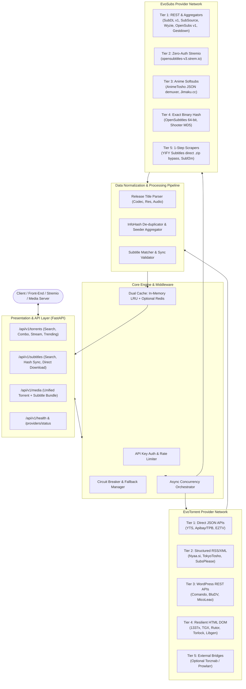
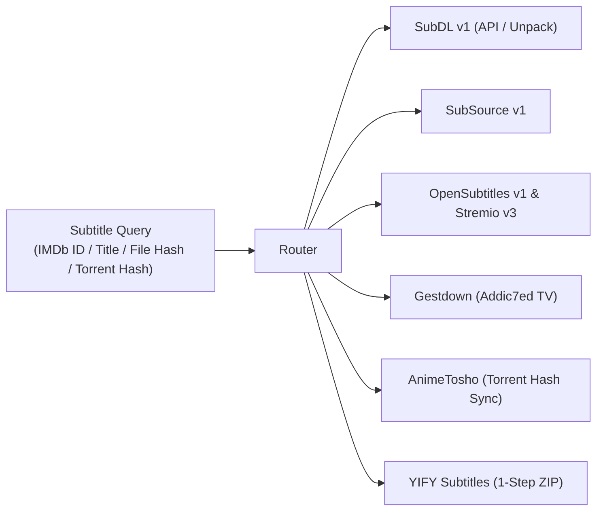

# EvoScrapper: Architectural Blueprint & Implementation Plan
**High-Performance, Fault-Tolerant Torrent & Subtitle Aggregation Platform**

---

## 1. Executive Summary & Vision

`EvoScrapper` is a next-generation, asynchronous torrent and subtitle scraping engine designed to replace legacy, fragile scrapers (like `Torrent-Api-py-main`) with a unified, high-resilience metadata platform.

By incorporating the architectural research from [`argon_1.txt`](file:///F:/Projects/Torrent%20scrapping%20Apis/argon_1.txt) and the subtitle extraction specifications from [`scrapping_torrents.md`](file:///F:/Projects/Torrent%20scrapping%20Apis/scrapping_torrents.md), `EvoScrapper` addresses the critical flaws of previous iterations:
- **Zero-Hang Aggregation**: Replaces brittle, synchronous-waiting multi-scrapers with per-provider circuit breakers, strict adaptive timeouts, and real-time Server-Sent Events (SSE) streaming.
- **API-First Prioritization**: Eliminates heavy HTML DOM scraping where official or unmetered JSON/RSS endpoints exist (e.g. switching YTS and The Pirate Bay to JSON APIs; Nyaa to XML RSS).
- **Purge of Dead Trackers**: Removes permanently defunct trackers (`Zooqle`, `GloDLS`, `MagnetDL`) that choke multi-indexer requests with timeouts.
- **Integrated Subtitle Engine ("EvoSubs")**: Fuses subtitle lookup with torrent search, allowing clients to query media by title, IMDb ID, or torrent `info_hash` to receive both magnets and synchronized subtitle files (`.srt`, `.vtt`, `.ass`) in a single payload.
- **Type-Safe Pydantic v2 Architecture**: Normalizes disparate upstream payloads into strict schemas with built-in release title parsing (resolution, codec, audio, source, group).

---

## 2. System Architecture



---

## 3. Component Deep Dive

### 3.1 Core Engine & Concurrency
* **Runtime**: Python 3.11+ / FastAPI / HTTPX with `AsyncClient` (HTTP/2 support, persistent keep-alive connection pooling, and custom SSL contexts).
* **Circuit Breakers**:
  - Each provider is wrapped in an isolated `CircuitBreaker`.
  - If a provider fails 3 consecutive times or exceeds the soft timeout (e.g. 3.5s), it transitions to `OPEN` status for 120 seconds.
  - Multi-tracker combo routes immediately skip `OPEN` providers, ensuring response times never exceed 4 seconds regardless of network conditions.
* **Domain & Mirror Failover**:
  - Providers define primary and fallback mirror URLs (e.g. `1337x.to` -> `1337x.st` -> `1337x.ws`).
  - If a DNS error or HTTP 5xx occurs on the primary mirror, the client automatically retries on the next mirror and updates provider health metrics.
* **Streaming Responses (SSE)**:
  - New route `/api/v1/torrents/stream`: Emits JSON events as each provider completes its search. Frontends render results incrementally without waiting for the slowest provider.

---

### 3.2 Torrent Provider Specifications

#### Tier 1: Direct JSON APIs (Ultra-Fast & Stable)
1. **YTS (`yts`)**:
   - URL: `https://yts.mx/api/v2/list_movies.json`
   - Parameters: `query_term={query_or_imdb_id}&limit=50&sort_by=seeds`
   - Advantage: Direct JSON output with official IMDb ID support, hashes, qualities, sizes, and seeder counts in a single request (replacing the legacy 10+ page HTML crawler).
2. **The Pirate Bay (`thepiratebay` via Apibay)**:
   - URL: `https://apibay.org/q.php?q={query_or_imdb_id}&cat=0`
   - Advantage: Official backend database JSON endpoint returning `info_hash`, `name`, `seeders`, `leechers`, and `size`. Completely bypasses mirror Cloudflare blocks and proxy ads.
3. **EZTV (`eztv`)**:
   - URL: `https://eztvx.to/api/get-torrents?imdb_id={numeric_imdb_id}&limit=100`
   - Advantage: Returns direct TV release magnet links and file hashes mapped to IMDb.

#### Tier 2: Structured RSS / XML Feeds
4. **Nyaa.si (`nyaa`)**:
   - URL: `https://nyaa.si/?page=rss&q={query}&c=0_0&f=0`
   - Parser: Fast XML parser (`defusedxml` / `lxml`) extracting `<nyaa:infoHash>`, `<nyaa:seeders>`, and `<nyaa:size>` directly without DOM table scraping.
5. **TokyoTosho (`tokyotosho`)**:
   - URL: `https://www.tokyotosho.info/rss.php?terms={query}&type=1`
   - Parser: RSS feed XML extracting CDATA magnet links.
6. **SubsPlease (`subsplease`)**:
   - URL: `https://subsplease.org/api/?f=search&tz=UTC&s={query}`
   - Advantage: Direct JSON feed for current season anime simulcasts with direct magnet links.

#### Tier 3: WordPress REST API (`wp-json`) Providers
7. **Comando (`comando`) & BluDV (`bludv`)**:
   - URL: `https://{domain}/wp-json/wp/v2/posts?search={query}&per_page=15`
   - Extraction: Regex scan against `content.rendered` (`magnet:\?xt=urn:btih:([a-fA-F0-9]{40}|[a-zA-Z2-7]{32})`).
   - Advantage: 100% structured JSON access to regional dual-audio media without headless browser overhead.

#### Tier 4: Resilient HTML DOM Scrapers
8. **1337x (`1337x`)**:
   - Mirror rotation: `1337x.to`, `1337x.so`, `1337x.st`.
   - Optimized 2-step async fetch with connection pooling.
9. **TorrentGalaxy (`torrentgalaxy`)**:
   - Accepts IMDb ID (`tt1234567`) or text query directly.
   - Extracts magnet link from the primary table row.
10. **Rutor (`rutor`)**:
    - URL: `http://rutor.info/search/0/0/000/0/{query}`
    - 1-step search table scraper; magnet link embedded directly in row `<a href="magnet:...">`.
11. **Torlock (`torlock`) & Libgen (`libgen`)**:
    - Preserved for verified books and general files with updated CSS selectors.

#### Trackers Removed:
- ❌ `zooqle`: Permanently shut down.
- ❌ `glodls`: Offline since 2023.
- ❌ `magnet_dl`: Offline since mid-2024.

---

### 3.3 Subtitle Provider Specifications ("EvoSubs")

The subtitle engine integrates all 5 tiers from [`scrapping_torrents.md`](file:///F:/Projects/Torrent%20scrapping%20Apis/scrapping_torrents.md):



1. **SubDL Provider (`subdl`)**:
   - Supports searching by IMDb ID, TMDB ID, and filename.
   - Leverages `unpack=1` parameter to provide direct individual `.srt` download URLs from season pack ZIPs without server-side storage.
2. **SubSource Provider (`subsource`)**:
   - Direct REST API matching release group names with official API keys.
3. **OpenSubtitles Provider (`opensubtitles`)**:
   - Combines OpenSubtitles REST API v1 (`api.opensubtitles.com/api/v1`) with the zero-auth public Stremio endpoint (`opensubtitles-v3.strem.io/subtitles/{type}/{id}.json`) as an automatic fallback.
4. **Gestdown Provider (`gestdown`)**:
   - Dedicated Addic7ed proxy for fast TV episode subtitle resolution by TVDB ID or show name.
5. **AnimeTosho Torrent Hash Matcher (`animetosho`)**:
   - **Unique capability**: Queries `feed.animetosho.org/json?show=torrent&btih={info_hash}`.
   - If a torrent was scraped from Nyaa or TokyoTosho, AnimeTosho returns the demuxed `.ass` and `.srt` subtitle files matching that exact torrent!
6. **YIFY Subtitles Scraper (`yifysubtitles`)**:
   - High-speed 1-step direct ZIP bypass: fetches IMDb movie table and rewrites `/subtitles/{slug}` to `https://yifysubtitles.ch/subtitle/{slug}.zip`.
7. **Exact Binary Hash Matcher (`hash_sync`)**:
   - Implements OpenSubtitles 64-bit uint64 file hashing (`compute_osdb_hash`) and Shooter.cn MD5 multi-offset hashing for clients providing raw video files.

---

## 4. Unified Data Pipeline & Normalization

Disparate payloads from HTML tables, RSS items, and JSON APIs are fed through a strict normalization pipeline:

### 4.1 Release Title Parser
Automatically extracts structured metadata from torrent titles (e.g. `Dune.Part.Two.2024.2160p.UHD.Remux.HEVC.DV.Atmos.TrueHD.7.1-FraMeSToR`):
- **Resolution**: `2160p (4K)`, `1080p`, `720p`, `480p`.
- **Quality / Source**: `REMUX`, `BluRay`, `WEB-DL`, `WEBRip`, `HDTV`, `CAM`.
- **Video Codec**: `AV1`, `HEVC (x265)`, `AVC (x264)`, `XviD`.
- **Audio Profile**: `Dolby Atmos`, `TrueHD 7.1`, `DTS-HD MA`, `DDP 5.1`, `AAC 2.0`.
- **Visual Tech**: `Dolby Vision (DV)`, `HDR10+`, `HDR10`, `SDR`.
- **Release Group**: `FraMeSToR`, `NTb`, `FLUX`, `YTS`, etc.

### 4.2 Deduplication Engine
When multiple providers return the same torrent:
- Merges duplicates using SHA-1 `info_hash`.
- Retains the highest reported seeder count.
- Compiles a list of confirmed `sources` (`["1337x", "TorrentGalaxy", "Apibay"]`).
- Formats a clean, multi-tracker magnet link combining all discovered tracker announce URLs.

---

## 5. Unified Data Schemas (Pydantic v2)

```python
class QualityMetadata(BaseModel):
    resolution: Optional[str] = None      # 2160p, 1080p, 720p
    source: Optional[str] = None          # REMUX, WEB-DL, BluRay
    codec: Optional[str] = None           # x265, x264, AV1
    audio: Optional[str] = None           # Atmos, DDP5.1, AAC
    hdr: Optional[List[str]] = []         # DV, HDR10+, HDR
    group: Optional[str] = None           # Release group name

class TorrentItem(BaseModel):
    id: str                               # Unique ID (info_hash or generated)
    title: str
    info_hash: Optional[str] = None       # 40-char SHA1 hex
    magnet_uri: str
    size_bytes: int
    size_formatted: str
    seeders: int
    leechers: int
    category: str                         # movies, tv, anime, books, apps, games
    upload_date: Optional[str] = None
    uploader: Optional[str] = None
    provider: str                         # Original provider
    sources: List[str] = []               # All providers confirming this hash
    metadata: QualityMetadata

class SubtitleItem(BaseModel):
    id: str
    provider: str
    language: str                         # English, Spanish, French, etc.
    lang_code: str                        # en, es, fr (ISO 639-1)
    format: str                           # srt, vtt, ass
    download_url: str
    release_name: Optional[str] = None
    is_hearing_impaired: bool = False
    rating: Optional[float] = None
    season: Optional[int] = None
    episode: Optional[int] = None

class UnifiedMediaBundle(BaseModel):
    query: str
    imdb_id: Optional[str] = None
    total_torrents: int
    total_subtitles: int
    torrents: List[TorrentItem]
    subtitles: List[SubtitleItem]
    execution_time_seconds: float
```

---

## 6. API Route Contracts

### 6.1 Torrent Endpoints
* `GET /api/v1/torrents/search`
  - Query Params: `query`, `provider` (`all` or specific), `category`, `resolution`, `min_seeders`, `sort_by`, `page`, `limit`.
* `GET /api/v1/torrents/combo`
  - Fans out queries across all healthy providers with deduplication and quality enrichment.
* `GET /api/v1/torrents/stream`
  - SSE endpoint (`text/event-stream`) streaming results per provider in real time.
* `GET /api/v1/torrents/trending`
  - Returns current trending items across movie and TV categories.

### 6.2 Subtitle Endpoints
* `GET /api/v1/subtitles/search`
  - Query Params: `query`, `imdb_id`, `tmdb_id`, `season`, `episode`, `language` (comma-separated), `format` (`srt`, `vtt`, `ass`), `hi` (`true`/`false`).
* `GET /api/v1/subtitles/by-hash`
  - Query Params: `info_hash` (torrent hash via AnimeTosho) OR `movie_hash` (OpenSubtitles 64-bit binary video hash).
* `GET /api/v1/subtitles/download`
  - Proxy download endpoint to resolve anti-hotlinking headers (such as Addic7ed's `Referer` requirement or YIFY direct unzipping).

### 6.3 Unified Media Endpoint
* `GET /api/v1/media/lookup`
  - Query Params: `query`, `imdb_id`, `season`, `episode`, `language`.
  - Concurrently queries both torrent indexers and subtitle repositories, returning a consolidated bundle ready for playback.

### 6.4 Operations & Diagnostics
* `GET /health`: Uptime, memory usage, version, and active background tasks.
* `GET /api/v1/providers/status`: Live circuit breaker state, latency, and success/failure ratios for each torrent and subtitle provider.

---

## 7. Directory Structure (`EvoScrapper/`)

```text
EvoScrapper/
├── PLAN.md                               # This document
├── requirements.txt                      # Dependencies (FastAPI, HTTPX, Pydantic v2, etc.)
├── .env.example                          # Config template (API keys, proxies, timeouts)
├── config.py                             # Settings management via Pydantic BaseSettings
├── main.py                               # FastAPI application setup & lifecycle hooks
├── core/
│   ├── client.py                         # Resilient HTTPX client with connection pooling
│   ├── circuit_breaker.py                # Circuit breaker & failure tracker
│   ├── cache.py                          # Dual-tier cache (In-memory + Redis)
│   ├── title_parser.py                   # Regex media release parser
│   └── security.py                       # API key authentication & rate limiting
├── models/
│   ├── torrent.py                        # TorrentItem, QualityMetadata, SearchQuery
│   ├── subtitle.py                       # SubtitleItem, SubtitleSearchQuery
│   └── common.py                         # HealthStatus, UnifiedMediaBundle
├── providers/
│   ├── base.py                           # Abstract BaseProvider with retry/metrics
│   ├── torrents/                         # Torrent scrapers
│   │   ├── yts.py                        # Tier 1: JSON API
│   │   ├── pirate_bay.py                 # Tier 1: Apibay JSON
│   │   ├── eztv.py                       # Tier 1: JSON API
│   │   ├── nyaa.py                       # Tier 2: XML RSS
│   │   ├── tokyotosho.py                 # Tier 2: XML RSS
│   │   ├── subsplease.py                 # Tier 2: JSON API
│   │   ├── comando.py                    # Tier 3: WordPress REST API
│   │   ├── bludv.py                      # Tier 3: WordPress REST API
│   │   ├── x1337.py                      # Tier 4: HTML Scraper
│   │   ├── torrent_galaxy.py             # Tier 4: HTML Scraper
│   │   ├── rutor.py                      # Tier 4: HTML Scraper
│   │   └── torlock.py                    # Tier 4: HTML Scraper
│   └── subtitles/                        # Subtitle scrapers
│       ├── subdl.py                      # SubDL v1 with ZIP unpack
│       ├── subsource.py                  # SubSource REST API
│       ├── opensubtitles.py              # OpenSubtitles v1 + Stremio v3 fallback
│       ├── gestdown.py                   # Addic7ed proxy
│       ├── animetosho.py                 # Softsub demuxer by torrent infoHash
│       ├── yify_subs.py                  # 1-step direct ZIP bypass
│       └── hash_matcher.py               # OpenSubtitles 64-bit & Shooter MD5
├── routers/
│   ├── torrents.py                       # Torrent API endpoints
│   ├── subtitles.py                      # Subtitle API endpoints
│   ├── media.py                          # Combined media bundle endpoint
│   └── health.py                         # Diagnostics and metrics
└── tests/
    ├── test_providers_torrents.py        # Live & mock tracker verification
    ├── test_providers_subtitles.py       # Subtitle API verification
    └── test_title_parser.py              # Release title regex verification
```

---

## 8. Implementation Roadmap & Milestones

### Phase 1: Core Framework & Foundation
- [ ] Initialize `requirements.txt` with modern dependencies (`fastapi`, `httpx`, `pydantic>=2.0`, `defusedxml`, `beautifulsoup4`, `cachetools`).
- [ ] Implement `core/client.py`, `core/circuit_breaker.py`, and `core/title_parser.py`.
- [ ] Establish base Pydantic models in `models/torrent.py` and `models/subtitle.py`.

### Phase 2: High-Performance Torrent Providers
- [ ] Implement Tier 1 JSON providers: `yts.py`, `pirate_bay.py` (via Apibay), `eztv.py`.
- [ ] Implement Tier 2 XML RSS providers: `nyaa.py`, `tokyotosho.py`, `subsplease.py`.
- [ ] Implement Tier 3 WordPress REST providers: `comando.py`, `bludv.py`.
- [ ] Implement Tier 4 resilient HTML scrapers: `x1337.py`, `torrent_galaxy.py`, `rutor.py`.

### Phase 3: Subtitle Scraping Engine ("EvoSubs")
- [ ] Implement `subdl.py` (with `unpack=1` direct link generation).
- [ ] Implement `gestdown.py` (Addic7ed TV proxy).
- [ ] Implement `opensubtitles.py` (API + Stremio v3 fallback).
- [ ] Implement `animetosho.py` (torrent `info_hash` ➔ extracted softsub matcher).
- [ ] Implement `yify_subs.py` (1-step `.zip` path rewrite).
- [ ] Implement `hash_matcher.py` (64-bit binary file hashing).

### Phase 4: Normalization, Deduplication & Aggregator Routers
- [ ] Build the de-duplication and seeder aggregation logic.
- [ ] Assemble `routers/torrents.py` (`/search`, `/combo`, `/stream`).
- [ ] Assemble `routers/subtitles.py` (`/search`, `/by-hash`, `/download`).
- [ ] Assemble `routers/media.py` (`/lookup` returning unified torrents + subtitles).

### Phase 5: Verification, Live Testing & Documentation
- [ ] Run test suite against real queries (`avatar`, `breaking bad`, `interstellar`) to confirm parsing accuracy.
- [ ] Benchmark response latencies and verify circuit breaker failover.
- [ ] Document local setup, Docker deployment, and OpenAPI usage.
