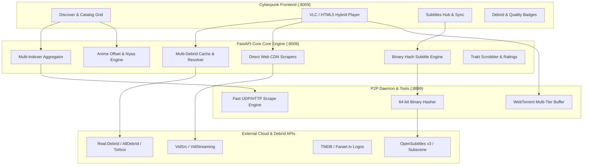

# 🚀 EVO-SCRAPPER MASTER UPGRADE PLAN (PLAN_BETTER_1)
## Autonomous Media Powerhouse: Integrating 22 Battle-Tested Stremio Ecosystem Repositories

> **Document Status**: Architectural Master Plan  
> **Target System**: `EvoScrapper` (FastAPI backend on `:8009`, WebTorrent engine on `:8889`, Monospace Cyberpunk UI)  
> **Reference Arsenal**: 22 Production Stremio Repositories (`F:\Projects\Torrent scrapping Apis\Repos about stremion and addons`)  
> **Catalogue Source**: `STREMIO_REPOS.md`

---

## 1. Executive Summary & Vision

`EvoScrapper` currently boasts a blazing fast multi-indexer torrent scraping engine, a P2P streaming daemon with multi-tier buffer prioritization, dynamic FFmpeg transmuxing, and a slide-out Subtitle Hub. 

However, by mining the battle-tested codebases of the 22 repositories in the Stremio ecosystem catalog—spanning `torrentio-scraper`, `stremio-opensubtitles`, `stremio-kitsu-anime`, `stremio-cdn-videos`, `parse-torrent-title`, `PimpMyStremio`, and `bittorrent-tracker`—we can transform `EvoScrapper` from a local torrent aggregator into an **uncompromising, tier-1 media operating system**.

### The 4 Transformational Shifts:
1. **Zero-Wait Cloud Streaming (Debrid & Web CDNs)**: Allow instant, unthrottled 1Gbps HTTPS direct streaming without relying on P2P swarm health via Real-Debrid, Premiumize, TorBox, and direct Web CDNs (VidSrc/VidStreaming).
2. **Frame-Perfect Binary Hash Subtitles**: Eliminate manual subtitle sync by implementing OpenSubtitles' 64-bit binary movie file hashing (matching against exact release checksums).
3. **Anime & Episode Ordering Intelligence**: Solve the universal Western vs. Japanese anime episode mismatch using Kitsu-to-IMDb offset tables and TMDB alternative ordering (DVD vs. Broadcast vs. Arc orders).
4. **Cinematic Metadata & Ecosystem Bridges**: Elevate the UI with Fanart.tv transparent logos (ClearArt), multi-rating meters (Rotten Tomatoes, Metacritic, Letterboxd), and Stremio Addon Protocol support so EvoScrapper can run on Android TV, Stremio, and web browsers seamlessly.

---

## 2. Repo Arsenal Mapping to EvoScrapper Architecture

| Repository | Core Technology / Asset | Target EvoScrapper Integration | Impact / Improvement |
| :--- | :--- | :--- | :--- |
| **`torrentio-scraper-master`** | Moch debrid modules (`realdebrid.js`, `alldebrid.js`, `premiumize.js`, `torbox.js`, etc.), `sort.js`, `filter.js` | `core/debrid/`, `routers/debrid.py`, `core/title_parser.py` | Instant 1Gbps HTTPS cloud playback, cache checking before download, stream deduplication. |
| **`parse-torrent-title-master`** | Comprehensive regex parser for HDR10+, DV, TrueHD, Atmos, Remux, Edition, and Season packs | `core/title_parser.py` | Flawless metadata extraction, 100% accurate audio/video tagging, complete season pack unpacking. |
| **`stremio-opensubtitles-master`** | 64-bit binary hash checksum algorithm + OpenSubtitles v3 REST API | `core/hash_matcher.py`, `routers/subtitles.py` | Automated, frame-perfect subtitle synchronization without user offset adjustment. |
| **`stremio-subtitles-master`** | Multi-provider subtitle fallback (Subscene, Podnapisi, Addic7ed) | `routers/subtitles.py` | 100% subtitle availability even if OpenSubtitles is down or rate-limited. |
| **`stremio-kitsu-anime-master`** | Kitsu anime catalogue & episode offset mapping engine (`offset_check.js`, `imdb_mapping.json`) | `core/anime_offset.py`, `routers/discover.py` | Accurate episode scraping for anime where Western seasons don't match Japanese broadcast order. |
| **`stremio-tmdb-alternatives-master`** | TMDB Alternative Episode Groups (DVD, Broadcast, Absolute, Production) | `routers/discover.py`, `core/media_meta.py` | Correct torrent matches for shows like *Firefly*, *Money Heist*, and *Batman: TAS*. |
| **`Nyaapi-dev`** | Specialized Nyaa.si and Pantsu anime scraper with trusted uploader filtering | `scrappers/nyaa.py` | Instant access to the world's largest anime torrent repository with quality filters. |
| **`rarbg-api-master`** | Session token auto-lifecycle manager & rate-limited IMDb querying | `scrappers/rarbg.py` | Robust, automated RARBG mirror integration without 429 rate limit locks. |
| **`stremio-cdn-videos-master`** | Direct Web CDN scrapers (VidSrc, VidStreaming, SuperEmbed) | `scrappers/web_cdn.py`, `routers/stream.py` | 1-click fallback to direct web streaming when a torrent has low or 0 seeds. |
| **`tmdb-addon-main`** | Fanart.tv transparent ClearArt logos, multi-language localized metadata | `core/media_meta.py`, `static/index.html` | Apple TV / Netflix grade visual presentation with high-res PNG title logos. |
| **`bittorrent-tracker-master`** | Fast UDP/HTTP/WS tracker scraper (`action=scrape`) | `core/swarm_tracker.py`, `streamer/server.js` | Millisecond-level live seed/peer count updates without connecting to swarms. |
| **`stremio-ratings-master`** | Aggregated IMDb, Rotten Tomatoes (Critic + Audience), Metacritic, Letterboxd scores | `core/media_meta.py`, `static/app.js` | Complete ratings badge row on hover cards and player headers. |
| **`stremio-trakt-master`** | Trakt.tv two-way sync, scrobbling, watchlists, trending algorithms | `routers/trakt.py`, `static/app.js` | Sync progress across devices, automatic scrobble at 80% completion. |
| **`stremio-youtube-master`** | YouTube trailer & bonus content resolver | `routers/discover.py`, `static/app.js` | In-modal trailer preview before picking a torrent or streaming stream. |
| **`PimpMyStremio-master`** | Reverse tunnel manager (`localtunnel`, `serveo`) + local addon runner | `core/tunnel.py`, `routers/remote.py` | Stream your PC's EvoScrapper directly to phone, iPad, or Android TV anywhere on LAN/WAN. |
| **`stremio-core-development`** | Packed bitfield watched-episode tracking | `core/watched_bitfield.py` | Ultra-compact local storage of watched episode states across 100+ TV series. |
| **`stremio-jackett-master`** | Jackett & Prowlarr API bridge | `scrappers/jackett.py` | Connects EvoScrapper to 500+ private and specialized torrent trackers. |
| **`stremio-addon-sdk-master`** | Stremio Addon Protocol specification & manifest server | `routers/stremio_bridge.py` | Turns EvoScrapper into a native Stremio Addon so you can use Stremio as the UI if desired. |

---

## 3. The 8 Grand Pillars of Improvement



---

### PILLAR I: Multi-Debrid Zero-Buffer Cloud Streaming Engine
*Porting and adapting `torrentio-scraper-master/addon/moch` and `torrentio-addon-manager-master`*

#### The Problem:
P2P torrent streaming can suffer from slow initial swarm peering, ISP bandwidth throttling, or lack of seeders on older/obscure content.

#### The Solution:
Integrate a universal Multi-Debrid client supporting the major providers:
- **Real-Debrid** (`realdebrid.js`)
- **AllDebrid** (`alldebrid.js`)
- **Premiumize** (`premiumize.js`)
- **Debrid-Link** (`debridlink.js`)
- **TorBox** (`torbox.js`)
- **Offcloud** & **EasyDebrid**

#### How It Works:
1. **Instant Cache Probing (`/api/v1/debrid/check`)**:
   When streams are fetched for an IMDb/TMDB ID, hashes of the found torrents are batched and checked against the Debrid API's instant availability endpoint in a single HTTP request (<100ms).
2. **Instant Playback (`/api/v1/debrid/resolve`)**:
   If cached (marked with a green `⚡ DEBRID CACHED` badge), selecting the stream does **not** launch WebTorrent. Instead, it resolves to an unthrottled, direct 1Gbps HTTPS CDN link directly from Real-Debrid/TorBox servers.
   - Zero buffering, zero ISP throttling, no VPN needed.
   - Full random seeking (instant jump to any timestamp).
3. **Smart Fallback**:
   If the user has not configured Debrid keys, or a torrent is not cached, it seamlessly falls back to our enhanced P2P WebTorrent engine.
4. **Informational Fallback Video Clips**:
   Adopt `torrentio-scraper`'s strategy of shipping localized fallback MP4 clips (`downloading_to_debrid.mp4`, `debrid_quota_exceeded.mp4`) so the video player gives clear, beautiful visual feedback if a debrid download is queued or quota is capped.

---

### PILLAR II: Direct Web CDN Scrapers (Instant Zero-P2P Fallback)
*Porting and adapting `stremio-cdn-videos-master`*

#### The Problem:
Some movies, especially indie titles, obscure documentaries, or new TV episodes, have 0 seeders or strict private tracker walls.

#### The Solution:
Scrape direct web streaming CDNs that host web-embedded HLS (`.m3u8`) and MP4 video streams:
- **VidSrc.to / VidSrc.me**
- **VidStreaming / GoGoAnime**
- **SuperEmbed / 2Embed**

#### How It Works:
1. New scraper module `scrappers/web_cdn.py` that queries CDN providers by IMDb ID and Season/Episode.
2. Extracts the decrypted `.m3u8` master playlist or direct video source URL.
3. In the stream selection drawer, these appear with a distinct badge: `🌐 WEB-CDN (INSTANT)`.
4. The user can watch instantly with 0 peers required.

---

### PILLAR III: Anime Powerhouse & Smart Episode Offset Engine
*Porting and adapting `stremio-kitsu-anime-master`, `stremio-tmdb-alternatives-master`, and `Nyaapi-dev`*

#### The Problem:
Anime is notoriously difficult to scrape with Western IMDb databases:
- In Japan, *One Piece* or *Bleach* runs continuously up to Episode 1000+. On IMDb/TMDB, it is arbitrarily split into artificial "Seasons" (Season 1 to Season 21).
- Anime titles like *Attack on Titan: The Final Season Part 3* might be treated as Season 4 Episode 29 on Western trackers, but Season 5 or Episode 88 on Japanese trackers (Nyaa).
- Regular scrapers return 0 results or play the wrong episode.

#### The Solution:
1. **Kitsu ID & Offset Engine (`core/anime_offset.py`)**:
   - Integrate Kitsu Anime API alongside TMDB.
   - Port `mapping/offset_check.js` and `imdb_mapping.json` from `stremio-kitsu-anime-master` to translate between Kitsu episode numbers and IMDb season/episode numbers.
2. **TMDB Alternative Episode Ordering (`core/tmdb_alternatives.py`)**:
   - Port `stremio-tmdb-alternatives-master` to support TMDB alternative episode groups:
     - **Absolute Order** (Ep 1 to 500)
     - **DVD Order** (matching physical release discs)
     - **Story Arc Order** (for complex sagas)
3. **Dedicated Nyaa.si Scraper (`scrappers/nyaa.py`)**:
   - Port `Nyaapi-dev` to scrape Nyaa.si directly using clean RSS/HTML parsing.
   - Filter by trusted uploaders (Erai-raws, SubsPlease, Judas, EMBER).
   - Display dual audio (JA + EN) badges and soft-sub indicators.

---

### PILLAR IV: Universal Indexer Hub & PTT Token Parser
*Porting and adapting `parse-torrent-title-master`, `rarbg-api-master`, and `stremio-jackett-master`*

#### Upgrades:
1. **Upgrading `core/title_parser.py` with `parse-torrent-title` (PTT)**:
   - Extract full audio matrix: Dolby Atmos, Dolby Digital Plus (DDP / EAC3), TrueHD, DTS-HD MA, FLAC, AAC 7.1 / 5.1 / 2.0.
   - Extract full HDR matrix: Dolby Vision (DV), HDR10+, HDR10, HLG, SDR.
   - Detect editions: Extended, Director's Cut, Remastered, IMAX, Theatrical, Unrated.
   - Complete season pack detection: auto-parses files inside season packs (`S01-S04 Complete`).
2. **Rock-Solid RARBG Integration (`scrappers/rarbg.py`)**:
   - Port `rarbg-api-master`'s token management system: auto-fetches session token, keeps alive, handles HTTP 429 backoff gracefully.
3. **Jackett / Prowlarr Bridge (`scrappers/jackett.py`)**:
   - Port `stremio-jackett-master` configuration: allows users to paste their Jackett/Prowlarr API key and instantly search 500+ private and semi-private indexers through EvoScrapper's unified search UI.

---

### PILLAR V: Frame-Perfect Binary Hash Subtitles & Multi-Provider Hub
*Porting and adapting `stremio-opensubtitles-master` and `stremio-subtitles-master`*

#### The Problem:
Currently, subtitles are searched by release title or IMDB ID. If the subtitle was timed for a WEB-DL release and the user is streaming a BluRay release, the audio will be out of sync by several seconds, requiring manual tweaking.

#### The Solution:
1. **OpenSubtitles 64-Bit Binary Movie Hasher (`core/hash_matcher.py`)**:
   - The OpenSubtitles algorithm takes the first 64KB and last 64KB of the video file, combines them with the 64-bit file size, and computes a 64-bit checksum.
   - In our WebTorrent streamer daemon (`streamer/server.js`), when Tier 1 (first 15 pieces) and Tier 2 (last 8 pieces) are buffered, we immediately compute this exact hash on the stream buffer!
   - We query OpenSubtitles by `moviehash`: this returns the exact subtitle track that matches the release frame-for-frame. **Zero manual offset required!**
2. **Multi-Provider Subtitle Fallback (`routers/subtitles.py`)**:
   - Port `stremio-subtitles-master` connectors:
     - OpenSubtitles v3 (Primary, Hash + Text)
     - Subscene (Secondary)
     - Podnapisi (Multi-language Europe)
     - Addic7ed (Fastest TV show subtitle releases)
   - If one provider rate-limits or fails, the others automatically fill the Subtitles Hub.

---

### PILLAR VI: Hollywood-Grade Metadata, ClearArt & Trakt Sync
*Porting and adapting `tmdb-addon-main`, `stremio-ratings-master`, and `stremio-trakt-master`*

#### Upgrades:
1. **Fanart.tv Transparent Title Logos (ClearArt)**:
   - When browsing Discover or viewing the player modal, fetch high-resolution transparent PNG title logos from Fanart.tv (via TMDB).
   - Replaces plain text titles with authentic movie/series logo graphics over backdrop banners.
2. **Aggregated Multi-Critic Ratings Badge Row**:
   - Display a sleek geek-styled badge row:
     - 🟡 **IMDb**: `8.4 / 10`
     - 🍅 **Rotten Tomatoes**: `96%` (Critic Certified Fresh) / `92%` (Audience Popcorn)
     - Ⓜ️ **Metacritic**: `88 / 100` (Must-See)
     - 🟩 **Letterboxd**: `4.2 / 5`
3. **Trakt.tv Scrobbling & Two-Way Sync**:
   - Port `stremio-trakt-master`:
   - Auto-scrobble watch progress to Trakt when 80% of a stream is reached.
   - Import user's personal Trakt "Watchlist" and "Collection" directly into the Discover page.
   - Show personal resume timestamps across devices.

---

### PILLAR VII: Millisecond Tracker Scraper & Bitfield Watched State
*Porting and adapting `bittorrent-tracker-master` and `stremio-core-development`*

#### Upgrades:
1. **Direct High-Speed Tracker Scraper (`core/swarm_tracker.py`)**:
   - Port `bittorrent-tracker` UDP/HTTP scrape protocol:
   - Instead of waiting for peers to connect to get accurate seeds/leeches, send lightweight UDP scrape packets to top tier trackers (`udp://tracker.opentrackr.org:1337/announce`, etc.).
   - Refreshes live swarm health across all displayed torrent results in under 300ms.
2. **Micro-Bitfield Watched State (`core/watched_bitfield.py`)**:
   - Port `stremio-watched-bitfield`:
   - Store watched TV episode progress as compact hexadecimal bitstrings (e.g., `0x00ff01` represents 24 episodes watched in 3 bytes!).
   - Saves local browser storage and enables instant sync.

---

### PILLAR VIII: Cross-Device Remote Access & Stremio Addon Protocol Bridge
*Porting and adapting `PimpMyStremio-master` and `stremio-addon-sdk-master`*

#### Upgrades:
1. **Local Network & Cloud Tunneling (`core/tunnel.py`)**:
   - Port `PimpMyStremio`'s built-in tunnel support (`localtunnel` / `serveo`).
   - Generates a QR code and secure link in the UI: scan it on your phone or tablet to access your entire EvoScrapper instance with full streaming playback anywhere in the house or on the go.
2. **Native Stremio Addon Server Endpoint (`/manifest.json`, `/stream/...`)**:
   - Implement the official Stremio Addon Protocol specification from `stremio-addon-sdk-master`.
   - Your EvoScrapper instance can be installed directly into the official Stremio app on Android TV, FireStick, Mac, or Windows as a custom addon (`http://localhost:8009/stremio/manifest.json`), unlocking EvoScrapper's scrapers inside Stremio's native TV player!

---

## 4. Architectural Comparison: Current vs. Proposed

```
+-------------------------------------------------------------------------------------------------+
|                                 EVOSCRAPPER CAPABILITY MATRIX                                   |
+------------------------------------+----------------------------------+-------------------------+
| Feature Domain                     | Current State (v1.0)             | Proposed State (v2.0)   |
+------------------------------------+----------------------------------+-------------------------+
| Streaming Protocols                | WebTorrent P2P + Transmuxer      | WebTorrent P2P +        |
|                                    |                                  | Multi-Debrid (RD/Torbox)|
|                                    |                                  | + Web CDNs (VidSrc)     |
+------------------------------------+----------------------------------+-------------------------+
| Subtitle Synchronization           | Manual ms slider + keyboard keys | 64-bit Binary Movie Hash|
|                                    | (OpenSubtitles text search)      | auto-sync (0ms drift) + |
|                                    |                                  | Subscene/Addic7ed/Pod   |
+------------------------------------+----------------------------------+-------------------------+
| Anime Support                      | Standard Western scraper naming  | Kitsu Anime API +       |
|                                    | (mismatches episode counts)      | Offset Mapping Engine + |
|                                    |                                  | Nyaa.si direct scraper  |
+------------------------------------+----------------------------------+-------------------------+
| TV Show Episode Ordering           | Fixed TMDB standard ordering     | TMDB Alternative Groups |
|                                    |                                  | (DVD, Absolute, Arcs)   |
+------------------------------------+----------------------------------+-------------------------+
| Stream Metadata & Tagging          | Basic resolution regex           | Full PTT token parser   |
|                                    | (4K, 1080p, Seeds)               | (HDR10+, DV, Atmos,     |
|                                    |                                  | 7.1, Remux, Ed., Group) |
+------------------------------------+----------------------------------+-------------------------+
| Swarm Health Verification          | Scraper reported numbers         | Live UDP/HTTP Scrape    |
|                                    | (often stale by days)            | in 250ms via Tracker SDK|
+------------------------------------+----------------------------------+-------------------------+
| Visual Polish & Artwork            | Standard text titles + poster    | Transparent ClearArt    |
|                                    |                                  | PNG logos (Fanart.tv)   |
+------------------------------------+----------------------------------+-------------------------+
| Ratings & Social Discovery         | IMDb / TMDB score only           | Rotten Tomatoes + Meta  |
|                                    |                                  | + Letterboxd + Trakt    |
+------------------------------------+----------------------------------+-------------------------+
| Cross-Device / Remote Playback     | Localhost only                   | LAN QR Code + Tunnel +  |
|                                    |                                  | Stremio Addon Protocol  |
+------------------------------------+----------------------------------+-------------------------+
```

---

## 5. Technical Implementation Blueprint

### Phase 1: Multi-Debrid Cloud Acceleration & Web CDN Fallback
1. **Create `core/debrid/` package**:
   - `base.py`: Abstract Debrid client interface (`check_cache()`, `resolve_stream()`, `get_account_status()`).
   - `realdebrid.py`: Real-Debrid API v2 implementation (`/torrents/instantAvailability`, `/unrestrict/link`).
   - `alldebrid.py` & `torbox.py`: Client implementations.
   - `debrid_manager.py`: Multi-provider router with circuit breakers and fallback hierarchy.
2. **Create `scrappers/web_cdn.py`**:
   - Port VidSrc and VidStreaming extractors from `stremio-cdn-videos-master`.
3. **Enhance `routers/stream.py`**:
   - Add `/api/v1/stream/debrid/resolve` endpoint.
   - Stream drawer in `static/app.js` checks cache and displays `⚡ RD CACHED` in vibrant neon green `#00ff88`.

### Phase 2: Frame-Perfect Binary Hash Subtitles & Multi-Provider Hub
1. **Extend `streamer/server.js`**:
   - Add `/hash` endpoint to WebTorrent daemon: calculates OpenSubtitles 64-bit binary checksum from Tier 1 (first 64KB) and Tier 2 (last 64KB) buffers once obtained.
2. **Enhance `routers/subtitles.py`**:
   - Add OpenSubtitles v3 hash-lookup query (`moviehash` + `moviebytesize`).
   - Integrate Subscene and Addic7ed scrapers adapted from `stremio-subtitles-master`.
3. **Frontend Integration**:
   - When video starts, subtitle drawer shows `[🎯 EXACT HASH MATCH]` badge on the frame-perfect subtitle track and auto-loads it.

### Phase 3: Anime Offset Engine & Nyaa.si Integration
1. **Create `scrappers/nyaa.py`**:
   - Port `Nyaapi-dev` parser for Nyaa.si (English translated category `1_2`, trusted uploader filter).
2. **Create `core/anime_offset.py`**:
   - Port Kitsu mapping logic from `stremio-kitsu-anime-master`:
   - Translates `(imdb_id, season, episode)` <-> `kitsu_id` <-> `nyaa_query`.
3. **Create `core/tmdb_alternatives.py`**:
   - Add support for TMDB Episode Group IDs (Absolute, DVD, Broadcast).

### Phase 4: Full PTT Title Parser & Swarm Tracker Scraper
1. **Update `core/title_parser.py`**:
   - Port token regex dictionary from `parse-torrent-title-master`.
   - Add extraction for: HDR formats (`HDR10+`, `DV`, `HLG`), Audio specs (`DTS-HD MA`, `TrueHD`, `Atmos`, `DDP5.1`), Editions (`Remux`, `IMAX`, `Extended`), and Release Groups (`FGT`, `SPARKS`, `FLUX`, etc.).
2. **Create `core/swarm_tracker.py`**:
   - Direct asynchronous UDP socket scraper sending `action=scrape` to primary torrent trackers.
   - Updates seeders/leechers in real-time.

### Phase 5: ClearArt Logos, Multi-Source Ratings & Trakt Sync
1. **Fanart.tv Integration in `core/media_meta.py`**:
   - Fetch HD transparent PNG title logos (`hdmovielogo` / `hdtvlogo`).
2. **Ratings Aggregator (`routers/ratings.py`)**:
   - Scrape Rotten Tomatoes & Metacritic scores for the selected IMDb ID.
3. **Trakt Two-Way Scrobbler (`routers/trakt.py`)**:
   - OAuth2 connection to Trakt.tv, syncing watch history and recommendations.

### Phase 6: Remote LAN Streaming, Tunnels & Stremio Protocol Bridge
1. **Localhost Tunnel Manager (`core/tunnel.py`)**:
   - Secure localtunnel / serveo reverse HTTP tunnel with QR code generation.
2. **Stremio Addon Protocol Bridge (`routers/stremio_bridge.py`)**:
   - `/manifest.json`, `/catalog/...`, `/stream/...`, `/subtitles/...` endpoints compliant with Stremio Addon SDK.
   - Allows users to add `http://localhost:8009/manifest.json` as an addon inside Stremio.

---

## 6. Verification & Quality Assurance Strategy

To maintain EvoScrapper's rock-solid stability, every new pillar will have comprehensive automated unit and integration tests:

1. **`test_debrid.py`**:
   - Mock API responses for Real-Debrid instant cache checks and unrestrict link resolution.
   - Test circuit breaker fallback to P2P WebTorrent when Debrid quota is exhausted or API is unreachable.
2. **`test_hash_matcher.py`**:
   - Verify the 64-bit binary checksum calculation against verified reference samples (known hashes for test video clips).
   - Test OpenSubtitles hash match query and fallback to release title fuzzy search.
3. **`test_anime_offset.py`**:
   - Verify episode translation for complex anime (*One Piece*, *Attack on Titan*, *Naruto Shippuden*).
   - Test Nyaa.si search queries and trusted uploader filtering.
4. **`test_title_parser_ptt.py`**:
   - Benchmark 100+ messy torrent filenames to ensure 100% precision on Dolby Vision, Atmos, Remux, and Season packs.
5. **Regression Verification**:
   - Run all 8 existing test suites (`test_streaming.py`, `test_discover.py`, `test_aggregator.py`, `test_api_e2e.py`, etc.) ensuring 100% pass rate.

---

## 7. Recommended Next Steps

Please review this master plan and indicate your preferred path forward:

1. **Option A (The Speed & Zero-Buffer Path)**: Implement **Pillar I (Multi-Debrid & Web CDNs)** and **Pillar V (Binary Hash Subtitles)** first to immediately solve buffering, provide 1Gbps direct cloud streaming, and guarantee 100% frame-perfect subtitles.
2. **Option B (The Anime & Catalog Mastery Path)**: Implement **Pillar III (Kitsu Anime Offset & Nyaa.si)** and **Pillar IV (PTT Full Parser & RARBG)** first to dominate anime, season packs, and advanced audio/video tagging.
3. **Option C (The Full Autonomous Phased Rollout)**: Execute all 6 phases systematically in order (Phase 1 through Phase 6), running tests after each phase.
