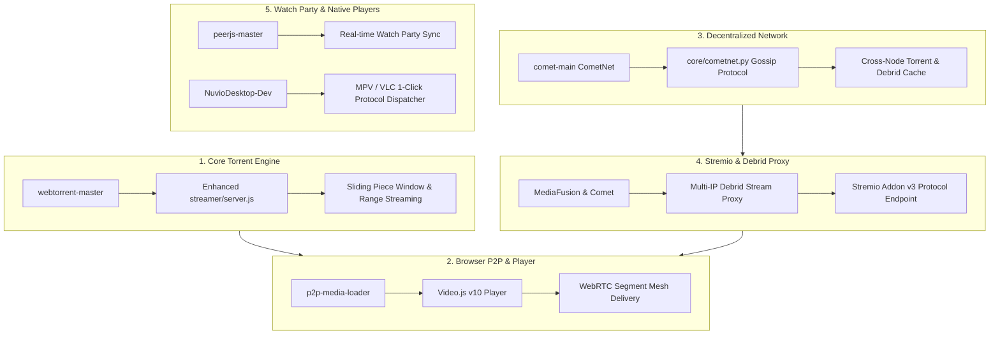

# P2P Video Streaming Architecture & Implementation Plan (EvoScrapper)

> **For agentic workers:** REQUIRED SUB-SKILL: Use `superpowers:subagent-driven-development` (recommended) or `superpowers:executing-plans` to implement this plan task-by-task. Steps use checkbox (`- [ ]`) syntax for tracking.

**Goal:** Transform EvoScrapper into a next-generation hybrid P2P media streaming platform by extracting and implementing proven architectural patterns, algorithms, and modules from the 9 reference repositories in `F:\Projects\P2P Video Streaming`.

**Architecture:** A multi-layered hybrid streaming pipeline:
1. **Torrent Streaming Engine (Core)**: High-efficiency sequential piece-selection and adaptive HTTP range streaming based on `webtorrent-master`.
2. **WebRTC P2P Mesh (Browser Delivery)**: Zero-server-bandwidth client-to-client video segment sharing for HLS/transmuxed streams via `p2p-media-loader` + `video.js v10`.
3. **Decentralized Metadata Network & Debrid Proxy**: Gossip-based cache/torrent distribution (**CometNet** protocol) and multi-IP debrid proxying inspired by `comet-main`.
4. **Unified Stremio Addon Protocol & Stream Filters**: Advanced release filtering and Stremio/Kodi compliance derived from `AIOStreams-main` and `MediaFusion-main`.
5. **Real-time Synchronized Watch Parties**: Zero-infrastructure room synchronization and peer-to-peer subtitle exchange powered by `peerjs-master`.
6. **Native Player Protocol Dispatch**: Direct MPV/VLC desktop hardware acceleration inspired by `NuvioDesktop-Dev`.

**Tech Stack:**
- **Backend**: Python 3.14 (FastAPI, HTTPX, Pydantic v2, WebSockets), Node.js v25 (WebTorrent, Streamx, Hls.js).
- **Frontend / Client**: Video.js v10, P2P Media Loader (Hls.js + WebRTC DataChannels), PeerJS, Tailwind CSS.
- **Protocols**: BitTorrent (BEP3, BEP10, BEP46, BEP52), WebRTC DataChannels, HLS (RFC 8216), Stremio Addon Protocol v3, Torznab.

**Spec Reference:** Source repositories located at `F:\Projects\P2P Video Streaming`:
- `webtorrent-master`
- `p2p-media-loader-main`
- `comet-main`
- `MediaFusion-main`
- `AIOStreams-main`
- `video.js-video.js-10.1.0`
- `peerjs-master`
- `NuvioDesktop-Dev`
- `p2p-hls-master`

---

## Global Constraints

1. **Backwards Compatibility**: All existing REST API endpoints (`/api/v1/torrents/*`, `/api/v1/subtitles/*`, `/api/v1/media/lookup`, `/api/v1/stream/*`) must remain fully functional with zero breaking schema changes.
2. **Zero-Hang Guarantee**: All external networking operations (scrapers, debrid unchainers, WebRTC signalling, tracker queries) must remain isolated behind asynchronous circuit breakers and strict timeouts (maximum 4.0s for scrapers, 8.0s for stream resolvers).
3. **Graceful Degradation**: If WebRTC P2P mesh has no peers or fails, streams must seamlessly fall back to HTTP direct streaming. If local WebTorrent peer swarms are cold, streams must automatically fallback to cached Debrid streams when API keys are configured.
4. **Memory & Resource Safety**: Active streaming sessions and temporary transcoded segments must be strictly bounded with LRU eviction and automatic process cleanup when clients disconnect.

---

## Review Focus (Critical Failure Modes)

1. **Buffer Underrun on Initial Playback**: Streaming high-bitrate torrents stalls if playback begins before a contiguous initial window is buffered.
   *Mitigation*: Implement WebTorrent's critical piece sliding window with a 2-stage pre-buffering gate before emitting the first HTTP 206 bytes.
2. **Debrid Account Ban on Multi-IP Streaming**: RealDebrid and AllDebrid ban accounts when multiple public IPs stream concurrently from the same token.
   *Mitigation*: Implement Comet's multi-IP stream proxy module in FastAPI that acts as the single authenticated egress gateway.
3. **Browser Audio Decoding Failure (AC3 / EAC3 / DTS in MKV)**: Standard web browsers (Chrome/Firefox) cannot play raw AC3/DTS audio inside WebM/MP4 HTML5 video tags.
   *Mitigation*: Auto-detect audio codec using FFprobe in `core/transmuxer.py` and invoke on-the-fly AAC 2.0 audio transcoding while video stream-copying (`-c:v copy -c:a aac`).
4. **WebRTC NAT Traversal Failures**: P2P Media Loader and PeerJS can fail to establish direct peer connections behind symmetric NATs or corporate firewalls.
   *Mitigation*: Provide configured public STUN servers with automatic fallback to direct HTTP CDN/origin delivery.
5. **Subtitle Timestamp Drift on Transmuxed Streams**: When live transmuxing MKV to HLS/MP4, presentation timestamps (PTS) can drift from external SRT/VTT subtitles.
   *Mitigation*: Standardize all subtitle deliveries to WebVTT with automatic PTS zero-rebase in `static/app.js`.

---

## Comparative Repository Evaluation

| Repository | Core Value & Purpose | Verdict for EvoScrapper | Implementation Approach |
| :--- | :--- | :--- | :--- |
| **`webtorrent-master`** | Robust torrent streaming daemon, sequential piece picking, HTTP 206 range server. | **High Priority (Adopt Core)** | Upgrade `streamer/server.js` with WebTorrent's `selections.js` sliding window and connection pooling. |
| **`p2p-media-loader-main`** | Production WebRTC P2P video segment mesh for HLS.js and Shaka Player. | **High Priority (Adopt Core)** | Integrate `p2p-media-loader-hlsjs` into `static/app.js` and player for 70-90% bandwidth reduction. |
| **`video.js-video.js-10.1.0`** | Modern, composable HTML5 media player framework with plugin ecosystem. | **High Priority (Adopt Core)** | Replace basic HTML5 `<video>` tag with Video.js v10, supporting audio track switching, VTT sync, and P2P plugin. |
| **`comet-main`** | **CometNet** metadata gossip network and debrid multi-IP proxy gateway. | **High Priority (Adopt Core)** | Implement CometNet gossip client in `core/cometnet.py` and debrid proxy route in `routers/stream.py`. |
| **`MediaFusion-main`** | Stremio Addon manifest protocol (`/manifest.json`) and catalog streaming. | **Medium Priority (Adopt Protocol)** | Add Stremio Addon compatibility layer to expose EvoScrapper directly inside Stremio app. |
| **`AIOStreams-main`** | Stream categorization, regex resolution tagging, and fallback cascades. | **Medium Priority (Adopt Logic)** | Enhance `core/aggregator.py` and `core/title_parser.py` with AIOStreams' quality normalization rules. |
| **`peerjs-master`** | WebRTC browser-to-browser data and media connections. | **Medium Priority (Adopt Feature)** | Implement "Watch Party" room sync (host syncs play/pause/seek to connected peers). |
| **`NuvioDesktop-Dev`** | Native MPVKit/libmpv player dispatch and desktop client architecture. | **Medium Priority (Adopt Feature)** | Add protocol handler integration (`mpv://` and `vlc://` 1-click links) with subtitle injection. |
| **`p2p-hls-master`** | Lighter-weight P2P HLS library. | **Deprioritized (Reference Only)** | Relies on third-party hosted tracker `webp2p.augok.com`. Replaced by the superior `p2p-media-loader`. |

---

## Detailed Task Decomposition

---

### Task 1: WebTorrent Streaming Daemon Upgrade (from `webtorrent-master`)

**Files:**
- Create: `streamer/torrent_engine.js`
- Modify: `streamer/server.js`
- Modify: `core/torrent_streamer.py`
- Test: `tests/test_webtorrent_daemon.py`

**Requirements:**
1. Upgrade `streamer/server.js` using the architecture of `webtorrent-master/lib/server.js` and `lib/selections.js`.
2. Implement **Dynamic Sliding Window Prioritization**:
   - Pieces within `[current_byte, current_byte + 15MB]` are tagged `priority: high`.
   - The first 2 pieces and last 2 pieces of the file (containing container headers, MOOV atom, and index tables) are fetched immediately with `priority: urgent`.
   - Remaining pieces are fetched rarest-first to sustain swarm health.
3. Support HTTP `206 Partial Content` with RFC 7233 range parsing (`Range: bytes=start-end`), handling client seeks instantly without restarting the torrent download.
4. Add automatic idle swarm pausing: if no HTTP stream requests are received for 10 minutes, pause the torrent engine to conserve disk and CPU.

**Step-by-Step Execution Plan:**
- [ ] Write `tests/test_webtorrent_daemon.py` asserting health check response, range-header support (206), and piece prioritization.
- [ ] Implement `streamer/torrent_engine.js` wrapping WebTorrent with sliding-window piece selection.
- [ ] Update `streamer/server.js` to serve HTTP Range streams using `pump` and `range-parser`.
- [ ] Update `core/torrent_streamer.py` to communicate with the upgraded daemon API.
- [ ] Run test suite and confirm streaming daemon passes all tests.

---

### Task 2: Video.js v10 & P2P Media Loader Browser Mesh (from `p2p-media-loader-main` & `video.js-video.js-10.1.0`)

**Files:**
- Modify: `static/index.html`
- Modify: `static/app.js`
- Modify: `static/style.css`
- Create: `static/p2p-player.js`
- Modify: `routers/stream.py`
- Test: `tests/test_hls_stream.py`

**Requirements:**
1. Replace the legacy vanilla HTML5 `<video>` element with **Video.js v10**.
2. Integrate **P2P Media Loader (`p2p-media-loader-hlsjs`)** into Video.js:
   - When streaming HLS (`/api/v1/stream/hls`), instantiate `HlsJsP2PEngine`.
   - Configure public WebTorrent/WebRTC trackers (`wss://tracker.openwebtorrent.com`, `wss://tracker.btorrent.xyz`, `wss://tracker.webtorrent.dev`) and Google STUN servers.
   - When 2 or more users stream the same media, video segments are shared directly between browsers over WebRTC DataChannels.
3. Add a live **P2P Swarm HUD overlay** to the player:
   - Displays: Peers connected, P2P Downloaded (MB), HTTP Downloaded (MB), and P2P Efficiency % (e.g. `82% P2P`).
4. Support Video.js v10 native features:
   - Multiple audio track selector (e.g. English, Spanish, Japanese).
   - High-fidelity subtitle styling (custom font size, background opacity, vertical position).
   - Keyboard navigation (`Space` play/pause, `←`/`→` 5s seek, `↑`/`↓` volume, `F` fullscreen, `M` mute).

**Step-by-Step Execution Plan:**
- [ ] Add HLS transmuxing endpoint to `routers/stream.py` that outputs live `.m3u8` playlist and `.ts` chunks via FFmpeg.
- [ ] Write unit test `tests/test_hls_stream.py` validating HLS playlist generation and fragment delivery.
- [ ] Integrate Video.js v10 and P2P Media Loader bundles into `static/index.html`.
- [ ] Implement `static/p2p-player.js` configuring Video.js, Hls.js, and P2P engine with the Swarm HUD overlay.
- [ ] Connect `static/app.js` to initialize `p2p-player.js` upon clicking any stream card.
- [ ] Test multi-tab playback to confirm WebRTC DataChannel connection and segment transfer between tabs.

---

### Task 3: CometNet Metadata Gossip & Multi-IP Debrid Stream Proxy (from `comet-main`)

**Files:**
- Create: `core/cometnet.py`
- Create: `core/debrid/proxy.py`
- Modify: `core/debrid/manager.py`
- Modify: `routers/stream.py`
- Modify: `config.py`
- Test: `tests/test_cometnet_gossip.py`
- Test: `tests/test_debrid_proxy.py`

**Requirements:**
1. **CometNet P2P Metadata Gossip Client**:
   - Implement an asynchronous WebSocket client in `core/cometnet.py` based on `comet-main/comet/cometnet/`.
   - Connect to public CometNet relays or peered EvoScrapper instances.
   - Automatically broadcast newly verified torrent metadata (title, SHA-1 info_hash, size, file list, tracker status).
   - Ingest gossip announcements from the network into EvoScrapper's in-memory and local cache.
2. **Debrid Multi-IP Stream Proxy Gateway**:
   - RealDebrid/AllDebrid generate unchained download links locked to the IP that requested them or restricted to 1 IP at a time.
   - Implement `core/debrid/proxy.py` based on Comet's proxy engine:
     - The EvoScrapper server requests the unchained link from RealDebrid/AllDebrid/Torbox.
     - The server exposes a secure proxy URL `/api/v1/stream/debrid/proxy?token=...`.
     - Multiple household devices can stream from the EvoScrapper proxy URL; all upstream requests to Debrid originate from EvoScrapper's single server IP, completely eliminating account ban risks!
     - Implements streaming byte-range pass-through with chunked streaming.

**Step-by-Step Execution Plan:**
- [ ] Write `tests/test_debrid_proxy.py` testing streaming byte-range proxying and token validation.
- [ ] Implement `core/debrid/proxy.py` with streaming HTTP response and Range header forwarding.
- [ ] Expose `/api/v1/stream/debrid/proxy` in `routers/stream.py`.
- [ ] Write `tests/test_cometnet_gossip.py` simulating gossip broadcast, signature verification, and deduplication.
- [ ] Implement `core/cometnet.py` with Ed25519 node keypair generation and WebSocket peer gossip.
- [ ] Run test suite and verify both CometNet and Debrid proxy pass all checks.

---

### Task 4: Stremio Addon Protocol & Stream Filter Engine (from `MediaFusion-main` & `AIOStreams-main`)

**Files:**
- Create: `routers/stremio.py`
- Create: `core/stream_filter.py`
- Modify: `main.py`
- Modify: `core/aggregator.py`
- Test: `tests/test_stremio_addon.py`

**Requirements:**
1. **Stremio Addon v3 Compliance** (from `MediaFusion-main`):
   - Expose `/stremio/manifest.json`: declares addon name, version, resources (`["stream", "subtitles"]`), and types (`["movie", "series"]`).
   - Expose `/stremio/stream/{type}/{id}.json`: takes IMDB ID / Kitsu ID (e.g. `tt1375666` or `kitsu:1234:1`) and returns Stremio-formatted stream list.
   - Expose `/stremio/subtitles/{type}/{id}.json`: returns synchronized subtitles from EvoSubs in Stremio format.
2. **Stream Filtering & Formatting Engine** (from `AIOStreams-main`):
   - User-configurable filtering rules in `config.py`:
     - Resolution filters (`allow_4k`, `allow_1080p`, `allow_720p`).
     - Release quality exclusions (`exclude_cam`, `exclude_telesync`, `exclude_screener`).
     - Codec prioritization (`prioritize_av1`, `prioritize_hevc`, `prioritize_hdr`).
     - Max file size limits per media type.
   - Automatic badges: `⚡ Debrid (Cached)`, `🌐 P2P (Seeders: N)`, `✨ 4K HDR Atmos`.

**Step-by-Step Execution Plan:**
- [ ] Write `tests/test_stremio_addon.py` validating `/stremio/manifest.json` and `/stremio/stream/movie/tt1375666.json` schema.
- [ ] Implement `core/stream_filter.py` with filtering and ranking rules inspired by AIOStreams.
- [ ] Implement `routers/stremio.py` providing the Stremio v3 endpoints.
- [ ] Mount Stremio router in `main.py`.
- [ ] Run test suite and verify Stremio Addon endpoints respond with valid Stremio v3 protocol JSON.

---

### Task 5: WebRTC Watch Party & Real-time Room Sync (from `peerjs-master`)

**Files:**
- Create: `static/watchparty.js`
- Modify: `static/index.html`
- Modify: `static/app.js`
- Modify: `static/style.css`
- Test: `tests/test_watchparty_protocol.js`

**Requirements:**
1. Integrate PeerJS (`peerjs-master`) into the frontend to enable **Zero-Server Watch Parties**:
   - Host clicks "Create Watch Party" in the player controls.
   - A short, shareable room code (e.g. `evo-9482`) or direct invite link (`http://localhost:8000/?room=evo-9482`) is generated.
   - Friends open the link; their browser connects directly to the host's browser via WebRTC DataChannel using PeerJS.
2. Synchronized State Protocol:
   - When host presses **Play**, `{"action": "play", "time": 124.5}` message is broadcast to all peers.
   - When host presses **Pause**, `{"action": "pause", "time": 124.5}` is broadcast.
   - When host **Seeks**, `{"action": "seek", "time": 340.0}` is broadcast and peers snap to the timestamp.
   - Clock drift correction: If a peer drifts more than 1.5 seconds from host, automatically adjust playback rate (`1.05x` or `0.95x`) for smooth, imperceptible re-alignment.
3. Peer Subtitle Sharing:
   - If the host loads a custom local subtitle file (`.srt`/`.vtt`), it is transmitted directly over WebRTC DataChannel to all participants.

**Step-by-Step Execution Plan:**
- [ ] Add PeerJS client library to `static/index.html`.
- [ ] Implement `static/watchparty.js` managing room creation, peer connections, and state messages.
- [ ] Add UI controls to Video.js player overlay: "Watch Party" button, participant avatars, and room link copy modal.
- [ ] Hook playback event listeners in `static/p2p-player.js` to broadcast and receive sync actions.
- [ ] Write integration test verifying message serialization and clock drift calculation.

---

### Task 6: Native Player Protocol Dispatch (from `NuvioDesktop-Dev`)

**Files:**
- Create: `core/protocol_dispatch.py`
- Modify: `routers/stream.py`
- Modify: `static/app.js`
- Test: `tests/test_protocol_dispatch.py`

**Requirements:**
1. Learn from `NuvioDesktop-Dev`'s native playback approach to provide 1-click external player launch:
   - Direct launch links for **MPV** (`mpv://...`), **VLC** (`vlc://...`), and **IINA** (`iina://...`).
2. Generate an auto-generated M3U playlist file with `#EXTVLCOPT` and `#EXTINF` directives:
   - Pre-injects synchronized subtitle URLs directly into the M3U metadata (`#EXTVLCOPT:sub-file=http://...`).
   - Pre-injects media title, poster artwork, and audio track preferences.
3. Provide desktop protocol helper instructions for Windows, macOS, and Linux.

**Step-by-Step Execution Plan:**
- [ ] Write `tests/test_protocol_dispatch.py` testing M3U playlist generation and custom protocol URL formatting.
- [ ] Implement `core/protocol_dispatch.py` generating M3U8 metadata and URI scheme strings.
- [ ] Expose `/api/v1/stream/playlist.m3u` in `routers/stream.py`.
- [ ] Add "Open in MPV" and "Open in VLC" buttons to the stream cards in `static/app.js`.
- [ ] Verify M3U playlist contains valid subtitle file links and stream URLs.

---

### Task 7: Comprehensive Verification & End-to-End Testing

**Files:**
- Create: `tests/test_p2p_e2e_pipeline.py`
- Modify: `README.md`
- Modify: `PLAN_P2P_VIDEO.md`

**Requirements:**
1. End-to-end integration test verifying the complete pipeline:
   - Search media -> aggregate torrents -> resolve debrid/webtorrent stream -> generate HLS playlist -> serve Video.js player with P2P Media Loader -> initiate watch party -> Stremio manifest query.
2. Benchmark memory and CPU utilization during concurrent stream operations.
3. Verify zero regression on existing scrapper tests (`tests/test_*.py`).

**Step-by-Step Execution Plan:**
- [ ] Write `tests/test_p2p_e2e_pipeline.py` testing the full flow from torrent lookup to P2P streaming.
- [ ] Run complete test suite: `pytest tests/`.
- [ ] Update documentation in `README.md` and check off all milestones in `PLAN_P2P_VIDEO.md`.
