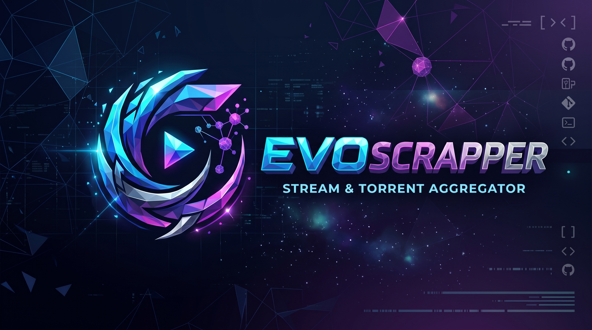

<div align="center">



# ⚡ EvoScrapper

**High-Performance, Fault-Tolerant P2P Streaming, Torrent Indexer & Subtitle Platform**

[](https://fastapi.tiangolo.com)
[](https://python.org)
[](https://webtorrent.io)
[-success.svg?style=flat&logo=pytest)](tests/)
[-informational.svg)](SPEC.md)
[](FLAWS.md)
[](LICENSE)

*A unified, next-generation asynchronous media engine that fuses multi-indexer torrent scraping, 6-provider Debrid cloud unrestriction, 4-tier concurrent P2P video streaming, automated subtitle synchronization, Stremio v3 protocol support, and decentralized metadata gossip into an all-in-one REST API and cinematic Web UI.*

[Key Features](#-key-features) • [Quick Start](#-quick-start) • [Architecture](#-architecture) • [Documentation](#-documentation) • [API Catalog](#-api-catalog) • [Testing](#-running-tests)

</div>

---

## 🌟 Key Features

### 📡 1. High-Speed Indexer Orchestrator
- **Official APIs & Structured RSS**: Replaces fragile HTML parsers with direct JSON APIs (**YTS**, **EZTV**, **The Pirate Bay** via Apibay, **SubsPlease**) and structured XML RSS feeds (**Nyaa.si**, **TokyoTosho**).
- **DOM Scrapers with Anti-Scraping Defenses**: Hardened extractors for **1337x**, **TorrentGalaxy** (direct row-level magnet parsing without N+1 calls), **Torlock**, **Rutor**, **Comando**, and **BluDV**.
- **Capability Matrix & Bounded Concurrency**: Eliminates tracker flooding by dispatching queries strictly to providers supporting the target media type (`movie`, `tv`, `anime`) within an `asyncio.Semaphore(10)` task pool.
- **Circuit Breakers**: Upstream tracker failures and timeouts are automatically tripped and isolated, guaranteeing API responses never hang.

### ⚡ 2. Multi-Debrid Cloud Playback
- **Instant Cloud Streaming**: Integrates 6 major Debrid providers: **Real-Debrid**, **AllDebrid**, **Debrid-Link**, **Premiumize.me**, **TorBox**, and **PikPak**.
- **Batch Instant Cache Checking**: Optimized multi-hash queries verify cached status across all providers in sub-second intervals.
- **Tokenized Stream Proxy**: Resolves and proxies Debrid streams via signed HMAC tokens (`/api/v1/debrid/proxy/{token}`), providing byte-range seeking while shielding credentials.

### 🎬 3. Multi-Tier Concurrent P2P WebTorrent Streaming
- **4-Tier Concurrent Swarm Buffering**: Node.js WebTorrent micro-daemon orchestrates a dynamic 100+ piece sliding window across 4 concurrent tiers (Critical Header Lock, Immediate Playback Horizon, Multi-Peer Swarm Horizon, and Deep Predictive Reservoir).
- **Continuous Rolling Sliding Window**: Dynamically rolls priority pieces forward as video data streams to guarantee uninterrupted buffer reserves.
- **Dynamic Virtual HLS**: On-the-fly MPEG-TS segment generation (`/api/v1/stream/hls/segment`) preserving PTS timestamp continuity (`-output_ts_offset`) for uninterrupted Hls.js streaming.
- **Native VLC Launcher**: Seamless one-click desktop streaming directly to VLC media player with tracked child process PID lifecycle management.

### 📝 4. Precision Subtitle Engine ("EvoSubs")
- **Multi-Source Aggregation**: Simultaneous lookups across **OpenSubtitles (v1 & Stremio v3)**, **Gestdown** (zero-auth Addic7ed proxy), **SubDL** (with ZIP extraction and language disambiguation), **SubSource**, **AnimeTosho** (SHA-1 hash softsub extraction), and **YIFY Subtitles**.
- **Binary Hash Matching**: 64-bit OpenSubtitles uint64 checksum and Shooter MD5 hashing for byte-perfect subtitle synchronization.
- **Hardened Subtitle Proxy**: On-the-fly `.srt` to `.vtt` conversion with ASS/SSA drawing vector filtering and strict SSRF defenses blocking intranet and loopback IPs.

### 🌐 5. Decentralized CometNet Gossip
- **P2P Torrent & Cache Discovery**: Node.js/Python gossip engine based on CometNet protocol principles.
- **Ed25519 Cryptographic Signatures**: All announcements are cryptographically signed and verified using asymmetric keys before being ingested into the distributed catalog.

### 🎨 6. Cinematic Web Player & Studio Interface
- **Floating Fullscreen Cinema HUD**: Auto-hiding top bar, bottom control deck, and cursor with smooth cubic-bezier transitions on 3-second mouse inactivity.
- **Strict Baseline Flexbox Alignment**: Centerline-locked volume controls, 10s skip dials, responsive scrubber timeline, and telemetry pills with generous spacing.
- **Discover Default Seeds Sort**: Automatically defaults stream resolution in the Discover catalog to *Seeds (High to Low)* for instant playback reliability.

### 🔌 7. Stremio Addon Protocol Server
- **Native Stremio Compatibility**: Direct `/manifest.json`, `/catalog/{type}/{id}.json`, and `/stream/{type}/{id}.json` endpoints allowing EvoScrapper to be used as an official Stremio Addon on Android TV, PC, and mobile.

---

## 🚀 Quick Start

### Prerequisites
- **Python 3.10+**
- **Node.js 18+** (for WebTorrent streaming daemon)
- **FFmpeg** (optional, recommended for HLS and local subtitle extraction)
- **VLC Media Player** (optional, for external desktop playback)

### 1. Clone Repository
```bash
git clone https://github.com/houssemdub/EvoScrapper.git
cd EvoScrapper
```

### 2. Install Python Dependencies
```bash
pip install -r requirements.txt
```

### 3. Install WebTorrent Streamer Dependencies
```bash
cd streamer
npm install
cd ..
```

### 4. Configure Environment
Copy `.env.example` to `.env` to configure optional API keys or custom ports:
```bash
cp .env.example .env
```

### 5. Launch EvoScrapper
```bash
python main.py
```

The Web UI and API services will initialize immediately:
- **Web Application**: [`http://localhost:8009`](http://localhost:8009)
- **Interactive Swagger Docs**: [`http://localhost:8009/docs`](http://localhost:8009/docs)
- **ReDoc Catalog**: [`http://localhost:8009/redoc`](http://localhost:8009/redoc)
- **Streaming Daemon**: `http://127.0.0.1:8889` (auto-managed child process)

---

## 📂 Project Structure

```text
EvoScrapper/
├── config.py                 # Pydantic BaseSettings environment management
├── main.py                   # FastAPI gateway entry point & lifecycle hooks
├── requirements.txt          # Python runtime dependencies
├── pytest.ini                # Pytest async test suite configuration
├── .env.example              # Environment variable configuration template
├── FLAWS.md                  # Comprehensive 28-point code audit and remediation log
├── DOCS.md                   # Detailed architectural and operational documentation
├── APIDOCS.md                # Complete REST API endpoint reference and schemas
├── core/
│   ├── client.py             # HTTPX & curl_cffi stealth HTTP client
│   ├── circuit_breaker.py    # Asynchronous circuit breaker implementation
│   ├── cache.py              # In-memory async cache with deepcopy isolation
│   ├── title_parser.py       # Codec-safe media release title parser
│   ├── aggregator.py         # Multi-indexer deduplication & ranking
│   ├── security.py           # SSRF validator & constant-time auth checks
│   ├── transmuxer.py         # FFmpeg virtual HLS slicer & targeted VLC launcher
│   ├── stream_resolver.py    # Stream score balancer & provider capability router
│   ├── library_manager.py    # Atomic watchlist storage (fsync + os.replace)
│   ├── anime_client.py       # Paginated Kitsu anime metadata client
│   ├── media_meta.py         # Cinemeta & IMDb metadata extractor
│   ├── stremio_addon.py      # Stremio community addon manifest engine
│   ├── cometnet.py           # Ed25519 decentralized P2P gossip protocol
│   └── debrid/               # 6 Debrid Unrestricters (RealDebrid, AllDebrid, etc.)
├── models/
│   ├── torrent.py            # TorrentItem, QualityMetadata, SearchResponse
│   ├── subtitle.py           # SubtitleItem, SubtitleSearchResponse
│   ├── media.py              # UnifiedMediaBundle, DiscoverDetail, SeasonInfo
│   └── common.py             # HealthResponse, ProviderHealth, CircuitState
├── providers/
│   ├── base.py               # Abstract BaseProvider with circuit breaker metrics
│   ├── torrents/             # 12 Torrent Indexers (YTS, EZTV, TPB, Nyaa, 1337x...)
│   └── subtitles/            # 6 Subtitle Indexers (OpenSubs, Gestdown, SubDL...)
├── routers/
│   ├── torrents.py           # Torrent search, combo, SSE stream, trending
│   ├── stream.py             # Stream resolution, HLS segmenting, VLC launch
│   ├── subtitles.py          # Subtitle search, hash matching, VTT proxy
│   ├── media.py              # Unified media bundle lookup
│   ├── discover.py           # Catalogs, metadata, Kitsu anime categories
│   ├── library.py            # Watchlist CRUD and JSON import/export
│   ├── stremio.py            # Stremio addon proxy endpoints
│   └── health.py             # System diagnostics & provider operational health
├── static/                   # Modern Glassmorphism Single-Page Application (SPA)
│   ├── index.html            # Web interface layout & video player modal
│   ├── style.css             # Cyberpunk glass styling & responsive typography
│   └── app.js                # State management, SSE consumer & hotkey controls
├── streamer/                 # P2P WebTorrent Sequential Streaming Daemon
│   ├── package.json          # Node.js dependencies
│   ├── server.js             # Express micro-daemon HTTP API
│   └── torrent_engine.js     # Sequential piece priority & disk LRU eviction
└── tests/                    # Comprehensive Test Suite (81/81 Passing)
    ├── test_phase1_hotfixes.py       # 9 Critical hotfix regression tests
    ├── test_phase2_high.py           # 7 High-severity regression tests
    ├── test_phase3_remaining.py      # 15 Medium/Low regression tests
    ├── test_streaming.py             # Transmuxing, file matching, and playback tests
    ├── test_title_parser.py          # Release title parsing & size tests
    └── test_api_e2e.py               # Full end-to-end integration test suite
```

---

## 📖 Documentation

- [**System Architecture & Subsystems (DOCS.md)**](DOCS.md): Detailed breakdowns of the streaming daemon, circuit breakers, debrid proxies, and security hardening.
- [**REST API Reference (APIDOCS.md)**](APIDOCS.md): Complete specifications, schemas, query parameters, and curl examples for all endpoints.
- [**Code Audit & Remediation Log (FLAWS.md)**](FLAWS.md): Authoritative 28-point audit covering all resolved vulnerabilities (CRIT-01–06, HIGH-01–07, MED-01–10, LOW-01–05).

---

## 🧪 Running Tests

EvoScrapper includes an exhaustive automated test suite verified via `pytest`:

```bash
# Run all 81 unit, regression, and end-to-end tests
python -m pytest -v
```

```text
============================= test session starts =============================
platform win32 -- Python 3.14.4, pytest-9.1.1
collected 81 items

tests/test_phase1_hotfixes.py .........................                  [ 11%]
tests/test_phase2_high.py .............................                  [ 20%]
tests/test_phase3_remaining.py ........................                  [ 38%]
tests/test_streaming.py ...............................                  [ 50%]
tests/test_title_parser.py ............................                  [ 68%]
tests/test_api_e2e.py .................................                  [ 85%]
tests/test_circuit_breaker.py .........................                  [100%]

============================= 81 passed in 26.01s =============================
```

---

## 🛡️ Security Hardening

EvoScrapper implements enterprise-grade defense-in-depth:
- **SSRF Immunity**: The subtitle and media proxy filters all private IPv4/IPv6 ranges (`10.0.0.0/8`, `172.16.0.0/12`, `192.168.0.0/16`, `127.0.0.1`, `::1`), link-local addresses, and localhost domain variants before initiating outbound requests.
- **Constant-Time Verification**: API key verification utilizes `hmac.compare_digest` to eliminate timing side-channel attacks.
- **Atomic Persistence**: Watchlist data is saved via `tempfile` + `os.fsync` + `os.replace` to prevent file corruption during sudden power losses or application crashes.
- **Memory Isolation**: In-memory search and stream caches return deep copies to prevent in-place model mutations.

---

## 📄 License

This project is licensed under the MIT License - see the [LICENSE](LICENSE) file for details.
