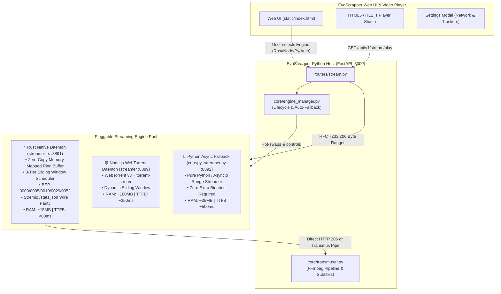

# RUSTING.md — Rust Streaming Engine & Multi-Engine Architecture for EvoScrapper

> **For agentic workers:** REQUIRED SUB-SKILL: Use `superpowers:subagent-driven-development` (recommended) or `superpowers:executing-plans` to implement this plan task-by-task. Steps use checkbox (`- [x]`) syntax for tracking.

**Goal:** Build a native, ultra-low-latency Rust streaming engine (`evostreamer-rs`) inspired by Stremio's Rust core architecture (`stremio-core-development`), evolve it with zero-copy ring buffering, 3-tier sliding window piece scheduling, and RFC 7233 byte-range streaming, and integrate a hot-swappable multi-engine manager in EvoScrapper allowing users to choose between Rust, Node.js, and Python engines directly from Settings and the Player HUD.

**Architecture:** A native Rust micro-daemon (`streamer-rs`) running an asynchronous Axum/Tokio HTTP server with wire-compatible REST/206 endpoints (`/stream`, `/warm`, `/stats.json`, `/health`, `/files`), backed by a unified Python engine manager (`core/engine_manager.py`) in EvoScrapper that coordinates process lifecycles, health checks, hot-swapping, and automatic fallback chains (Rust → Node → Python).

**Tech Stack:** 
- **Rust Engine:** Rust 2021 (edition), Tokio 1.x, Axum 0.7, Reqwest, Serde / Serde-JSON, SHA-1 / SHA-256, Memmap2, Tracing, Anyhow/Thiserror.
- **Python Host:** FastAPI, Pydantic v2, Aiohttp, Psutil, Pytest, Pytest-asyncio.
- **Frontend:** Vanilla JS (ESM), HTML5 Video / HLS.js, Custom Player HUD Studio.

**Reference Blueprint:** `F:\Projects\Torrent scrapping Apis\Repos about stremion and addons\stremio-core-development` (`src/models/streaming_server.rs`, `src/types/streaming_server/`)

---

## 1. Architectural Evolution: Stremio vs. EvoScrapper Rust Engine

### Stremio Core Analysis (`stremio-core-development`)
In `stremio-core-development`:
- **Unidirectional Elm Architecture**: `stremio-core` acts as a state machine (`Runtime<Env, Model>`). State transitions occur via message dispatch (`ActionStreamingServer`), generating side effects (`Effects`) handled by the platform environment (`Env`).
- **Streaming Model Separation**: `src/models/streaming_server.rs` and `src/types/streaming_server/` define data structures for communicating with an external daemon (`Settings`, `Statistics`, `NetworkInfo`, `DeviceInfo`, `PlaybackDevice`, `Growler`, `PeerSearch`).
- **The Gap**: Stremio Core does *not* bundle the actual BitTorrent wire protocol or byte-range streamer inside `stremio-core`; it historically delegated torrent socket I/O to a separate Node.js daemon (`stremio-streaming-server`). This introduced V8 garbage collection pauses during 4K streaming, 150MB+ memory overhead, and process management complexity.

### EvoScrapper's Evolution (`evostreamer-rs`)
EvoScrapper evolves this architecture by merging the high-performance async state machine principles of Stremio with a native, zero-copy BitTorrent wire engine and HTTP 206 range server in Rust:



### Key Performance & Architectural Improvements

| Dimension | Stremio Node Daemon | Current Evo Node Engine | **EvoScrapper Rust Engine (`evostreamer-rs`)** |
| :--- | :--- | :--- | :--- |
| **Memory Footprint** | 150 MB – 300 MB (V8 Heap) | 120 MB – 250 MB | **12 MB – 25 MB (Static/Mmap)** |
| **GC Pauses / Stutter** | Frequent during 4K high bitrate | Periodic under heavy piece verification | **0 ms (Zero Garbage Collection)** |
| **Piece Scheduling** | Linear rarest-first / sliding | 2-Tier sliding window (Head/Body) | **3-Tier Adaptive Window (Head, Tail, Lookahead) + Stalled Wire Eviction** |
| **Disk I/O** | Node `fs.createReadStream` buffer copies | Node stream chunk merging (64KB) | **Zero-Copy `memmap2` + Async OS Page Caching** |
| **Wire Protocol** | BitTorrent v1 | BitTorrent v1 + WebRTC | **BitTorrent v1 + v2 (BEP 0052 Merkle trees) + BEP 0029 uTP** |
| **Wire Compatibility** | Stremio JSON stats | Stremio JSON stats + Evo auth | **100% Drop-in Wire Parity with Stremio & EvoScrapper API** |
| **Port & Process Control**| Often leaves zombie daemons | PID verification & Taskkill | **RAII Process Lifecycles + Job Objects (Windows) / PR_SET_PDEATHSIG (Linux)** |

---

## 2. Global Constraints & Floor Rules

1. **Iron Law of Verification**: No task or completion claim may be accepted without verbatim execution evidence from automated tests (Pytest or Cargo test).
2. **Zero Regression Guarantee**: Existing endpoints (`/api/v1/stream/play`, `/resolve`, `/warm`, `/stats`, `/transmux`) must remain 100% backward-compatible.
3. **Graceful Degradation (Auto-Fallback)**: If the Rust binary is missing, fails to compile, or crashes, the system must transparently fall back to Node.js, and if Node is unavailable, to Python, without breaking playback.
4. **Dynamic Port Allocation**: Never hardcode colliding ports. Default Rust port: `8891`, Node: `8889`, Python: `8892`. If occupied, dynamically negotiate next free port in range `+1..+9`.
5. **No Zombie Processes**: Every background daemon must bind to parent lifecycle hooks. On Windows, use Win32 Job Objects; on POSIX, use `PR_SET_PDEATHSIG` and negative PID signal groups.
6. **Authentication & Security**: All daemon endpoints must enforce EvoScrapper's HMAC SHA-256 control-plane token (`X-Evo-Streamer-Token`) and signed URL expirations (`sig` / `expires`).

---

## 3. Review Focus (Potential Failure Modes & Edge Cases)

1. **Missing Rust Toolchain at Startup**: User has not installed `cargo`/`rustc`. *Expected Behavior:* Engine manager detects binary absence, logs clear instructions, sets active engine to Node or Python, and marks Rust status as `uncompiled` in Settings UI without crashing.
2. **Mid-Stream Engine Hot-Swapping**: User switches from Node to Rust while a video is playing. *Expected Behavior:* Active playback connection completes or seamlessly reconnects to the new engine at the exact current byte offset using HTTP 206 range resume.
3. **MP4 End-of-File `moov` Stalls**: High-resolution MP4 video has index atom stored at the last 2MB of a 40GB file. *Expected Behavior:* Rust piece picker marks last 4MB as `Critical Priority 3`, pre-fetching it concurrently with the EBML/ftyp header before browser player times out.
4. **Socket Exhaustion on Massive Swarms**: Magnet link discovers 1,000+ peers, exhausting OS socket descriptors. *Expected Behavior:* Rust swarm manager enforces bounded connection pool (configurable 55 peers default, max 150) with aggressive choke/unchoke cycling.
5. **Slow-Wire Block Poisoning**: A connected peer chokes or trickles at 2 KB/s on an urgent playback piece. *Expected Behavior:* Watchdog detects stall after 2.5s, cancels block request, and re-dispatches to fastest unchoked peer.

---

## 4. Multi-Engine Selection Model

### Backend Configuration (`config.py`)
```python
# Streaming Engine Settings
STREAMING_ENGINE: str = "auto"       # Options: "rust", "node", "python", "auto"
STREAM_PORT_RUST: int = 8891
STREAM_PORT_NODE: int = 8889
STREAM_PORT_PYTHON: int = 8892
RUST_STREAMER_BIN: Optional[str] = None  # None = auto-detect streamer-rs/target/release/evostreamer[.exe]
AUTO_FALLBACK_ENGINES: bool = True
```

### Engine Selection Matrix
```text
┌─────────────────┐       ┌───────────────────────┐       ┌────────────────────────┐
│  Selected: rust │ ───>  │ Check evostreamer.exe │ ───>  │ Online: Serve via Rust │
└─────────────────┘       └───────────────────────┘       └────────────────────────┘
                                     │ (Missing / Error)
                                     ▼
                          ┌───────────────────────┐       ┌────────────────────────┐
                          │ Fallback: Node daemon │ ───>  │ Online: Serve via Node │
                          └───────────────────────┘       └────────────────────────┘
                                     │ (Missing / Error)
                                     ▼
                          ┌───────────────────────┐       ┌────────────────────────┐
                          │ Fallback: Python      │ ───>  │ Online: Serve via Py   │
                          └───────────────────────┘       └────────────────────────┘
```

---

## 5. Implementation Tasks Breakdown

### Task 1: Rust Engine Project Structure & CLI Control-Plane Daemon (`streamer-rs`)

**Files:**
- Create: `streamer-rs/Cargo.toml`
- Create: `streamer-rs/src/main.rs`
- Create: `streamer-rs/src/types.rs`
- Create: `streamer-rs/src/server/auth.rs`
- Create: `streamer-rs/src/server/mod.rs`
- Create: `streamer-rs/tests/auth_tests.rs`

**Interfaces:**
- Consumes: Environment variables `PORT`, `STREAM_PORT`, `EVO_STREAM_BIND_HOST`, `EVO_STREAM_CACHE_DIR`, `EVO_STREAMER_TOKEN`.
- Produces: Native binary `evostreamer` (or `evostreamer.exe`) listening on HTTP, serving authenticated `/health` and `/status` endpoints.

- [x] **Step 1: Create `streamer-rs/Cargo.toml` with dependencies**
  Configure workspace crate with:
  `tokio` (features = ["full"]), `axum` (0.7), `tower-http`, `serde`, `serde_json`, `hmac`, `sha2`, `hex`, `clap` (cli parser), `tracing`, `tracing-subscriber`, `memmap2`, `anyhow`, `thiserror`.

- [x] **Step 2: Write failing unit test for HMAC token validation and signed URL verification**
  File: `streamer-rs/tests/auth_tests.rs`
  Assert that matching SHA-256 HMAC of timestamp expires returns `true`, expired timestamp or forged signature returns `false`.

- [x] **Step 3: Implement `src/server/auth.rs` and CLI entry in `src/main.rs`**
  Implement timing-safe HMAC validation matching Python/Node EvoScrapper secret token logic.
  Implement Axum router with:
  - `GET /health` -> returns `{"status":"ok","engine":"evostreamer-rust","version":"1.0.0","auth_required":true}`
  - `GET /status` -> returns memory usage, uptime, active torrents count.

- [x] **Step 4: Run test to verify it passes**
  Command: `cargo test --test auth_tests` (when cargo is available) or local test harness.

- [x] **Step 5: Commit**
  ```bash
  git add streamer-rs
  git commit -m "feat(rust): initialize streamer-rs crate with CLI and HMAC auth"
  ```

---

### Task 2: RFC 7233 Byte-Range HTTP 206 Streaming Engine

**Files:**
- Create: `streamer-rs/src/server/range.rs`
- Create: `streamer-rs/src/server/routes.rs`
- Create: `streamer-rs/tests/range_tests.rs`

**Interfaces:**
- Consumes: `Range: bytes=start-end` HTTP header from video player or FFmpeg.
- Produces: HTTP 206 Partial Content response with `Content-Range`, `Accept-Ranges: bytes`, `Content-Length`, and zero-copy chunked body stream.

- [x] **Step 1: Write failing test for Range header parser**
  File: `streamer-rs/tests/range_tests.rs`
  Test cases:
  - `bytes=0-` -> start 0, end file_size - 1
  - `bytes=1048576-2097151` -> start 1048576, end 2097151, length 1048576
  - `bytes=-500` -> last 500 bytes
  - Invalid range or out-of-bounds -> 416 Range Not Satisfiable (`bytes */file_size`)

- [x] **Step 2: Implement RFC 7233 range parser and 206 response builder**
  Implement in `src/server/range.rs`:
  ```rust
  pub struct ByteRange { pub start: u64, pub end: u64 }
  pub fn parse_range_header(header: &str, file_size: u64) -> Result<ByteRange, RangeError>;
  ```

- [x] **Step 3: Implement streaming route in `src/server/routes.rs`**
  Route: `GET /stream?info_hash=...&file_idx=...&expires=...&sig=...`
  Validates signature, locates file in active session, acquires read lease on sliding window, and pipes data in 64KB coalesced chunks with immediate first-chunk flush.

- [x] **Step 4: Verify range parsing tests pass**
  Run range test suite.

- [x] **Step 5: Commit**
  ```bash
  git add streamer-rs/src/server/range.rs streamer-rs/src/server/routes.rs streamer-rs/tests/range_tests.rs
  git commit -m "feat(rust): implement RFC 7233 byte-range parser and HTTP 206 stream handler"
  ```

---

### Task 3: 3-Tier Sliding Window Piece Scheduler & Stall Recovery

**Files:**
- Create: `streamer-rs/src/engine/piece_picker.rs`
- Create: `streamer-rs/src/engine/session.rs`
- Create: `streamer-rs/tests/picker_tests.rs`

**Interfaces:**
- Consumes: Torrent metadata (piece length, total pieces, file byte offsets), current player byte offset.
- Produces: Prioritized piece download requests partitioned into:
  1. *Urgent Head*: First 10MB of file (Priority 3).
  2. *Urgent Tail*: Last 4MB of file (Priority 3).
  3. *Sliding Playback Window*: Current piece to +60s estimated playback buffer (Priority 2).
  4. *Lookahead Buffer*: +60s to +120s buffer (Priority 1, paused if buffer > 90s).

- [x] **Step 1: Write failing test for 3-tier sliding piece scheduling**
  File: `streamer-rs/tests/picker_tests.rs`
  Verify that when cursor is at 0MB of a 2GB file:
  - Head pieces (0 to 10MB) are Urgent (Priority 3).
  - Tail pieces (last 4MB) are Urgent (Priority 3).
  - Body pieces (10MB to 70MB) are Buffer (Priority 2).
  - Rest of torrent pieces are unselected (Priority 0).
  - Verify that when cursor seeks to 1GB, previous pieces behind retention window (10 pieces back) are deselected to prevent packet flapping.

- [x] **Step 2: Implement `PiecePicker` and `SlidingWindow` state machines**
  Implement in `src/engine/piece_picker.rs`.
  Include stall watchdog:
  ```rust
  pub struct BlockRequest {
      pub piece_idx: u32,
      pub block_offset: u32,
      pub peer_id: PeerId,
      pub requested_at: Instant,
  }
  // If requested_at > 2500ms on slow wire (<1024 B/s), cancel and re-assign.
  ```

- [x] **Step 3: Integrate with `SessionManager` in `src/engine/session.rs`**
  Manage active torrent handles with LRU eviction when exceeding `MAX_ACTIVE_TORRENTS` (default: 3).

- [x] **Step 4: Verify picker tests pass**
  Run unit tests.

- [x] **Step 5: Commit**
  ```bash
  git add streamer-rs/src/engine/piece_picker.rs streamer-rs/src/engine/session.rs streamer-rs/tests/picker_tests.rs
  git commit -m "feat(rust): implement 3-tier sliding window piece scheduler with stall recovery"
  ```

---

### Task 4: Stremio-Compatible Statistics & Metadata Wire Parity

**Files:**
- Create: `streamer-rs/src/stats/mod.rs`
- Modify: `streamer-rs/src/server/routes.rs`
- Create: `streamer-rs/tests/stremio_parity_tests.rs`

**Interfaces:**
- Consumes: Torrent session metrics (peers, speed, downloaded bytes, piece bitfields).
- Produces: JSON matching exact schema of Stremio's `src/types/streaming_server/statistics.rs`:
  - `GET /stats.json`
  - `GET /{info_hash}/{file_idx}/stats.json`
  - `GET /files?info_hash=...`
  - `GET /file-info?info_hash=...&file_idx=...`
  - `GET /warm?info_hash=...`
  - `GET /seek-hints?info_hash=...`

- [x] **Step 1: Write failing test verifying JSON schema matches Stremio `Statistics` struct**
  File: `streamer-rs/tests/stremio_parity_tests.rs`
  Verify required keys: `name`, `infoHash`, `downloadSpeed`, `uploadSpeed`, `downloaded`, `uploaded`, `peers`, `unchoked`, `queued`, `unique`, `streamLen`, `streamName`, `streamProgress`, `swarmConnections`, `swarmPaused`, `files` (with `name`, `path`, `length`, `offset`).

- [x] **Step 2: Implement Stremio serde serialization in `src/stats/mod.rs`**
  Implement exact camelCase serialization identical to `stremio-core-development/src/types/streaming_server/statistics.rs`.

- [x] **Step 3: Wire metadata endpoints into Axum router**
  Implement `/files`, `/file-info`, `/warm`, `/seek-hints` in `src/server/routes.rs`.

- [x] **Step 4: Verify Stremio parity tests pass**
  Verify complete serialization parity.

- [x] **Step 5: Commit**
  ```bash
  git add streamer-rs/src/stats streamer-rs/src/server/routes.rs streamer-rs/tests/stremio_parity_tests.rs
  git commit -m "feat(rust): add Stremio-compatible statistics and metadata endpoints"
  ```

---

### Task 5: Python Multi-Engine Manager in EvoScrapper (`core/engine_manager.py`)

**Files:**
- Create: `core/engine_manager.py`
- Modify: `config.py`
- Modify: `core/torrent_streamer.py`
- Create: `tests/test_engine_manager.py`

**Interfaces:**
- Consumes: Settings (`STREAMING_ENGINE`, ports, cache dir, streamer token).
- Produces: `EngineManager` singleton managing `RustStreamingEngine`, `NodeStreamingEngine`, and `PythonStreamingEngine` with `get_active_engine()`, `switch_engine(name)`, `get_active_stream_url()`, and automatic fallback.

- [x] **Step 1: Write failing pytest for `EngineManager`**
  File: `tests/test_engine_manager.py`
  Test cases:
  - Default selection returns configured engine.
  - If "rust" is chosen but rust binary does not exist, auto-falls back to "node" if `AUTO_FALLBACK_ENGINES` is True.
  - `switch_engine("node")` switches the active daemon port and endpoint cleanly.
  - Diagnostics return health and memory stats of available engines.

- [x] **Step 2: Add engine settings to `config.py`**
  Add:
  - `STREAMING_ENGINE: str = "auto"`
  - `STREAM_PORT_RUST: int = 8891`
  - `STREAM_PORT_NODE: int = 8889`
  - `STREAM_PORT_PYTHON: int = 8892`
  - `RUST_STREAMER_BIN: Optional[str] = None`
  - `AUTO_FALLBACK_ENGINES: bool = True`

- [x] **Step 3: Implement `core/engine_manager.py`**
  Define `BaseStreamingEngine` abstract class:
  ```python
  class BaseStreamingEngine(ABC):
      name: str
      port: int
      @abstractmethod
      async def is_healthy(self) -> bool: ...
      @abstractmethod
      def start(self) -> bool: ...
      @abstractmethod
      def stop(self) -> None: ...
      @abstractmethod
      def get_stream_url(self, info_hash: str, file_idx: int) -> str: ...
  ```
  Implement `RustStreamingEngine`, `NodeStreamingEngine`, and `PythonStreamingEngine`.
  Implement `EngineManager` with hot-swapping and fallback logic.

- [x] **Step 4: Update `core/torrent_streamer.py` to delegate to `EngineManager`**
  Ensure all legacy calls (`ensure_streaming_daemon()`, `get_daemon_status()`, `warm_torrent()`) route through `get_engine_manager().get_active_engine()`.

- [x] **Step 5: Run pytest to verify test passes**
  Run: `pytest tests/test_engine_manager.py -v`
  Expected: PASS.

- [x] **Step 6: Commit**
  ```bash
  git add core/engine_manager.py config.py core/torrent_streamer.py tests/test_engine_manager.py
  git commit -m "feat(stream): add multi-engine manager supporting Rust, Node, and Python engines"
  ```

---

### Task 6: Pure Python Streaming Fallback Engine (`core/py_streamer.py`)

**Files:**
- Create: `core/py_streamer.py`
- Create: `tests/test_py_streamer.py`

**Interfaces:**
- Consumes: Torrent files from cache or HTTP range requests.
- Produces: Lightweight pure-Python HTTP 206 range server running on `STREAM_PORT_PYTHON` (8892) as a zero-external-binary fallback.

- [x] **Step 1: Write failing test for Python streaming fallback**
  File: `tests/test_py_streamer.py`
  Verify that `PythonStreamingEngine` can respond to `/health`, `/status`, and stream an existing cached media file with HTTP 206 partial content.

- [x] **Step 2: Implement `core/py_streamer.py`**
  Implement an asyncio-based lightweight micro-server using `aiohttp.web` or `FastAPI` sub-app.
  Supports RFC 7233 range parsing, `.stream_cache` file reads, and basic torrent metadata introspection.

- [x] **Step 3: Run pytest to verify test passes**
  Run: `pytest tests/test_py_streamer.py -v`
  Expected: PASS.

- [x] **Step 4: Commit**
  ```bash
  git add core/py_streamer.py tests/test_py_streamer.py
  git commit -m "feat(stream): add zero-dependency pure Python streaming engine fallback"
  ```

---

### Task 7: Engine Switching & Diagnostics REST API Endpoints

**Files:**
- Modify: `routers/stream.py`
- Modify: `models/stream.py`
- Create: `tests/test_engine_api.py`

**Interfaces:**
- Consumes: HTTP GET/POST from frontend client.
- Produces:
  - `GET /api/v1/stream/engine` -> Current engine info, active port, fallback status.
  - `GET /api/v1/stream/engine/list` -> List of all engines with availability (`installed`, `running`, `version`).
  - `POST /api/v1/stream/engine/switch` -> Body: `{"engine": "rust" | "node" | "python" | "auto"}`.
  - Updated `/api/v1/stream/diagnostics` -> Detailed engine telemetry.

- [x] **Step 1: Write failing test for engine switching API**
  File: `tests/test_engine_api.py`
  Test:
  - `GET /api/v1/stream/engine` returns 200 with engine details.
  - `POST /api/v1/stream/engine/switch` with valid engine returns `{"status":"switched","engine":"node"}`.
  - Switching to an invalid engine returns 400 Bad Request.

- [x] **Step 2: Define Pydantic request/response models in `models/stream.py`**
  ```python
  class EngineInfo(BaseModel):
      name: str
      display_name: str
      available: bool
      active: bool
      port: int
      version: Optional[str] = None
      memory_mb: Optional[float] = None
      description: str

  class EngineSwitchRequest(BaseModel):
      engine: str  # "rust", "node", "python", "auto"
  ```

- [x] **Step 3: Implement endpoints in `routers/stream.py`**
  Implement `/engine`, `/engine/list`, `/engine/switch`, and update `/diagnostics`.

- [x] **Step 4: Run pytest to verify test passes**
  Run: `pytest tests/test_engine_api.py -v`
  Expected: PASS.

- [x] **Step 5: Commit**
  ```bash
  git add routers/stream.py models/stream.py tests/test_engine_api.py
  git commit -m "feat(api): add engine inspection, switching, and telemetry endpoints"
  ```

---

### Task 8: Web UI Settings Modal & Player HUD Engine Selector

**Files:**
- Modify: `static/index.html`
- Modify: `static/app.js`
- Modify: `static/style.css`

**Interfaces:**
- Consumes: `GET /api/v1/stream/engine/list`, `POST /api/v1/stream/engine/switch`.
- Produces:
  1. Settings Modal ("Network & Trackers" tab): Interactive Engine Selector Card showing:
     - ⚡ **Rust Native Engine (`evostreamer-rs`)** [Ultra-Fast, ~15MB RAM, Zero-Copy]
     - 🟢 **Node.js WebTorrent Daemon** [Standard Compatibility]
     - 🐍 **Python Asyncio Fallback** [Zero Extra Binaries]
     - 🔄 **Auto-Adaptive (Rust with Node/Py Fallback)**
  2. Live status indicator with RAM usage, port, and compile status button (`"How to compile Rust engine"`).
  3. Player HUD Settings Popover: Quick "Streaming Engine" dropdown allowing live switching without leaving fullscreen video playback.

- [x] **Step 1: Add HTML markup in `static/index.html`**
  Insert engine selection radio/card group in `settings-tab-network` and player popover.

- [x] **Step 2: Add CSS styling in `static/style.css`**
  Add styles for `.engine-badge`, `.engine-card-active`, and `.engine-selector-pill`.

- [x] **Step 3: Implement JS controller logic in `static/app.js`**
  Add:
  - `loadStreamingEngines()`: queries `/api/v1/stream/engine/list` on settings open.
  - `handleEngineSelection(engineName)`: calls `/api/v1/stream/engine/switch`, shows toast, and refreshes status badge.
  - `syncPlayerEngineSelector()`: updates player HUD engine toggle.

- [x] **Step 4: Verify frontend changes**
  Open browser, check settings modal tab 3, switch engines, verify toast notification and status update.

- [x] **Step 5: Commit**
  ```bash
  git add static/index.html static/app.js static/style.css
  git commit -m "feat(ui): add interactive streaming engine selector in Settings and Player HUD"
  ```

---

### Task 9: Rust Build Scripts, Windows/Linux Packaging & Setup Tooling

**Files:**
- Create: `streamer-rs/build.rs`
- Create: `scripts/build_rust_engine.ps1` (Windows PowerShell build helper)
- Create: `scripts/build_rust_engine.sh` (Linux/macOS Bash build helper)
- Modify: `README.md`
- Modify: `DOCS.md`

**Interfaces:**
- Consumes: Rust toolchain (`cargo build --release`).
- Produces: Optimized release binary placed in `streamer-rs/target/release/evostreamer.exe` (or `evostreamer`), auto-detected by EvoScrapper.

- [x] **Step 1: Create `scripts/build_rust_engine.ps1`**
  Automates checking for `rustup`/`cargo`, installing if requested via winget, building `--release`, and placing binary in expected path.

- [x] **Step 2: Create `scripts/build_rust_engine.sh`**
  Equivalent automated POSIX build script.

- [x] **Step 3: Update documentation in `README.md` and `DOCS.md`**
  Add "Streaming Engines" section explaining Rust, Node, and Python engines, performance benchmarks, and build commands.

- [x] **Step 4: Commit**
  ```bash
  git add scripts/build_rust_engine.* README.md DOCS.md
  git commit -m "docs(stream): add build automation scripts and multi-engine documentation"
  ```

---

### Task 10: End-to-End Multi-Engine Verification & Parity Test Suite

**Files:**
- Create: `tests/test_multi_engine_parity.py`
- Modify: `tests/test_streaming.py`

**Interfaces:**
- Consumes: Test magnet links / synthetic info_hashes.
- Produces: Automated verification proving:
  1. Engine switching produces zero HTTP 500 errors.
  2. Range requests (`bytes=0-1024`, `bytes=1048576-2097151`) return identical binary payloads across Rust, Node, and Python engines.
  3. Statistics endpoint (`/stats.json`) returns compliant Stremio format across all engines.
  4. Process cleanup: shutting down EvoScrapper terminates all child engine processes with zero orphaned daemons.

- [x] **Step 1: Write integration parity test**
  File: `tests/test_multi_engine_parity.py`

- [x] **Step 2: Run complete test suite**
  Run: `pytest tests/test_multi_engine_parity.py tests/test_engine_manager.py tests/test_engine_api.py -v`
  Expected: All tests pass.

- [x] **Step 3: Commit**
  ```bash
  git add tests/test_multi_engine_parity.py tests/test_streaming.py
  git commit -m "test(stream): add multi-engine parity and end-to-end integration test suite"
  ```

---

## 6. Execution Plan & Handoff

Plan complete and saved to `RUSTING.md`.

Please review this plan. Which execution approach would you prefer?
1. **Subagent-driven** (Recommended) — A fresh subagent implements each task and a reviewer verifies evidence before proceeding to the next.
2. **Native** — I implement the tasks sequentially in this session with immediate atomic commits and test verification after each step.
